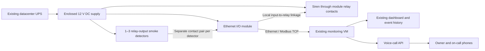

# Simple UPS-powered smoke detection for the monitoring VM

Rewritten for Hormuz Data Center, Ilam Province, Iran, on 13 October 2026. Scope: **1–3 wired smoke detectors, one Ethernet I/O module and one audible alarm**, integrated with your existing monitoring VM. You perform all installation, testing and programming. All parts, instructions, estimates and the final one-page summary are in this Markdown file.

## Recommended setup

Start with **two 12 V photoelectric smoke detectors with isolated relay outputs**: one for the general rack room and one inside the contained hot aisle. Add a third for a surveyed adjacent electrical room or separate smoke pocket. Connect each detector to its own input on a **Waveshare Modbus POE ETH Relay (B), SKU 27876**. This device converts contact states into values the VM can read over Ethernet and also provides relays for the siren.

Use your **existing datacenter UPS**. Plug one enclosed 12 V DC supply into a UPS-backed outlet and power the detectors, module and siren from it. Keep the Ethernet switch, VM host, firewall/router and Internet equipment on the same UPS-backed power system. There is **no separate battery, charger, fire panel, physical telephone dialer or paid labor** in this proposal. UPS runtime remains the limit during a prolonged outage; test the complete power path.

The two-detector purchase budget is **30,656,760 Iranian tomans (IRT)**, including 20% contingency, before tax. Three detectors cost **32,612,760 IRT** on the same basis. These are planning estimates; imported hardware availability and current local quotations need checking.

This baseline detects **smoke**, rather than flame or temperature. Your rack temperature sensors remain separate measurements. If you want heat detection as well, substitute a documented combined smoke/heat detector with the same 12 V supply and isolated relay interface, then revise its price and test both functions. Ordinary two-wire panel detectors, including the earlier ZITEX selection, are not a direct replacement for a relay-output detector.

## Ethernet choices and buying specification

| Option | How the VM reads it | Decision |
| --- | --- | --- |
| **Relay-output detectors + Waveshare Ethernet I/O** | Modbus TCP input states through one LAN address | Recommended: generic contacts, one interface for 1–3 detectors, and siren relays in the same box |
| AKCP SK00 + compatible sensorProbe hub | Network monitoring through the hub | Packaged alternative; requires the manufacturer's hub and the correct enabled sensor ports |
| Detector advertised with an RJ45 socket | Depends on its actual protocol | Buy as a direct Ethernet detector only if its manual confirms Ethernet/IP, a local readable API and its power requirements |

The Waveshare **(B)** model has eight digital inputs and eight relay outputs; the similarly named model without **(B)** lacks the detector inputs. It supports dry contacts, Modbus TCP and 7–36 V DC power, as well as optional PoE. The baseline uses 12 V DC and an ordinary Ethernet switch port, so no PoE injector is needed. [Manufacturer product page and USD price](https://www.waveshare.com/catalog/product/view/id/6496/s/modbus-poe-eth-relay-b/category/340/).

AKCP offers a smoke sensor and network hub, but its sensor connectors are hub interfaces, not direct LAN ports. Confirm the hub's port licensing before buying. [AKCP smoke-sensor datasheet](https://akcp-downloads.s3-us-west-2.amazonaws.com/Sensor/Environmental/SK00-Smoke-Detector.pdf), [sensorProbe2+ specifications](https://www.akcp.com/sensorprobe2plus/).

For local procurement, **ARIAK APDA-12R** is a quote candidate: a Persian supplier's indexed price list describes a 12 V relay-output photoelectric detector at **1,530,000 IRT**. That is an indicative listing reference, not a verified checkout price or a reviewed manufacturer wiring manual. Obtain the actual unit's manual, base inclusion and contact diagram before ordering. [Local ARIAK price-list reference](https://eshayan.com/brands-ariak-price-list/).

Your detector purchase requirements are: external 12 V DC power; photoelectric sensing; an **isolated contact pair open normally and closed on smoke alarm**; a documented reset method; and a mounting base. Reject a model that only provides a panel-current signal, requires a proprietary panel, or cannot provide the required contact behavior. Do not infer pin assignments or relay behavior from the model name. An integrated sounder is optional because this design includes a separate siren.

## Placement for the 18 m² rack room

Use the coordinates in the [airflow proposal](airflow-proposal.md): southwest corner `(0,0)`, x along 4.5 m and y along 4 m. The rack row occupies y=1.60–2.80 m; the hot aisle is y=2.80–4.00 m.

| Detector count | Placement |
| --- | --- |
| 1 | Near the center of an open, unobstructed room ceiling, approximately `(2.25, 2.00)` m, only if racks/ducts and containment do not divide smoke travel |
| **2 recommended** | D1 over the general/cold-side room, candidate `(2.25, 0.60)` m; D2 inside the contained hot aisle, candidate `(2.25, 3.40)` m, beneath its roof if it has one |
| 3 | Keep D1/D2; place D3 at the ceiling of a surveyed adjacent electrical room or another distinct smoke pocket |

These are starting locations, not fixed drilling coordinates. Keep detectors out of ventilation jets; initially allow **0.5 m from walls/major obstructions and 1 m from supply inlets**, following the selected detector manual. Check ducts, ceiling beams and hot-aisle roofing with fans running. If the narrow aisle cannot accommodate a suitable location, revise placement or use an air-sampling design. A detector above the containment roof cannot monitor smoke trapped beneath it. A point detector is not a duct detector. [Hochiki detector-siting guidance](https://www.hochikieurope.com/guides/BS5839_GUIDE_(V18_MAR18).pdf).

Mount the interface and DC supply in an accessible enclosure near the rack room entrance. Put the siren where it can be heard inside the room and at the operator approach with the door shut. Test with fans at normal maximum duty; if one siren is inadequate, add another and resize the supply allowance.

## Wiring: detector contacts to Ethernet



Use low-voltage wiring and a ready-made enclosed mains adapter; no new mains circuit is included. Start with a **12 V, 3 A regulated supply** and check its rating against the measured module load plus all detector alarm loads and siren load, with approximately 25% headroom. Fuse outgoing branches to suit their wiring and loads. Verify 12 V at the farthest detector while the siren operates.

| Connection | What you wire |
| --- | --- |
| Detector power | Fused +12 V and 0 V to each detector's documented power terminals |
| Detector alarm | Its isolated normally-open alarm contact pair to the corresponding module input and DGND, following the module's passive dry-contact diagram; leave its input COM unconnected as specified for this mode |
| Network | Module Ethernet port to existing switch; switch to the monitoring VLAN/VM |
| Module power | 12 V to its DC power terminals; do not assume Ethernet feeds power to the detectors |
| Siren power | Fused +12 V to relay 1 COM; relay 1 NO to siren positive; siren negative to supply 0 V |
| Additional detectors | Wire relay 2/3 COM to the same fused +12 V, and their NO contacts in parallel with relay 1 NO to the same siren positive |
| Detector reset | A labeled normally-closed momentary switch in each detector's positive power branch, used only for the interruption duration stated in its manual |

Configure relay 1 to follow input 1, relay 2 to follow input 2, and relay 3 to follow input 3 using the module's **linkage mode**. Their parallel isolated contacts give a simple “any detector sounds the siren” function. This local linkage continues without the VM or LAN, provided the module and DC supply remain powered. Linkage-mode relays are controlled by their inputs rather than VM commands. Confirm mode persistence and operation after a power cycle. [Manufacturer wiring and linkage-mode instructions](https://www.waveshare.com/wiki/Modbus_POE_ETH_Relay_%28B%29).

Use one four-core run per detector: two conductors for power and two for its isolated contact. Budget **40 m total**, then measure actual routes. Keep power and alarm labels distinct; never put detector supply voltage onto a dry-contact input. Separate the siren power pair from signal wiring. These simple inputs are **not supervised fire-alarm loops**: an open alarm wire or a detector that loses power can look like “no smoke.” Ethernet freshness checks do not detect that condition. Include physical detector tests in your routine.

If a detector latches, investigate and clear the smoke, then reset using its own documented method. The VM must retain the event until you acknowledge it, even if a self-resetting detector's contact opens. This is a monitoring-bench integration, not a certified building fire-alarm or suppression-release controller. Keep the independent door-release and suppression functions in the [security](security-proposal.md) and [suppression](fire-suppression-proposal.md) proposals separate from this VM.

## Programming on your existing VM

Use one small service on the existing Linux VM. Read the module over **Modbus TCP**, publish named detector states to the existing MQTT/dashboard path and call an Iranian voice API on an alarm. No Arduino, USB passthrough, separate database or replacement monitoring stack is needed. Store a small durable event/retry journal on the VM; the existing [rack-monitoring stack](rack-monitoring-proposal.md) can display the results.

| Setting | Initial implementation |
| --- | --- |
| Network | Reserved module IP; allow VM access to its configured Modbus TCP port only; no Internet port forwarding |
| Inputs | D1=input 1, D2=input 2, D3=input 3; verify function code 02 and the input address/bit order against the supplied firmware manual before using it |
| Polling | Read the input block every 2 seconds with a bounded timeout; latch an alarm on the first valid active state |
| Read failure | Retain previous alarm latch; mark current readings unknown/stale immediately; raise an interface-offline event after 10 seconds without a valid reply |
| Dashboard | Per detector: normal/alarm/unknown, location, last valid reading, latched event and acknowledgment; display contact state, not a smoke-concentration number |
| Call event | Notify owner, primary and backup contact on each new alarm event; deduplicate by event ID |
| Repetition | Repeat unacknowledged warnings every 5 minutes; stop repeats only after an authenticated operator acknowledgment |
| Recovery | Clear the dashboard latch only when the contact is normal and the event has been checked/acknowledged; acknowledgment must not electrically reset detectors |
| Restart | Run under systemd with restart-on-failure; reload the journal, reconcile active inputs and pending calls, and never start by assuming “normal” |

Implementation outline, to adapt to your existing collector:

```text
load detector map, contact numbers and persisted alarm/retry journal
repeat every 2 seconds:
    read current input states with a short network timeout
    on failure: set freshness unknown; preserve latched alarms; retry next poll
    on success:
        publish states and reception timestamp
        for each newly active detector:
            persist event ID, detector/location and call jobs
            latch dashboard alarm
    process due call jobs independently of polling with bounded HTTP timeouts
    record provider response IDs and failures; retry transient failures
    save acknowledgments and repeat deadlines across service restarts
```

For automatic warning calls, **Kavenegar documents `call/maketts.json`** with `receptor` and `message`. Use its SDK or an HTTPS client to send a short Persian site/address warning to each nominated contact. Confirm account activation, unrestricted warning-message support and a real answered test call before relying on it. An HTTP/API success means the request was accepted, not that someone heard the message. [Kavenegar official voice-call documentation](https://kavenegar.com/rest.html), [official SDK call method](https://github.com/kavenegar/kavenegar-php/blob/master/src/KavenegarApi.php).

Keep API credentials in a restricted service configuration and redact them from logs; the provider's API URL contains the key. Do not block input polling while making calls. Deduplicate local retry jobs; if a request times out after submission, record the uncertain outcome rather than assuming it was never sent. Internet/provider failure prevents calls but does not stop the module's local siren linkage. This Internet voice service uses no local SIM or cellular dialer.

## Your installation and test sequence

| Stage | Your work | Time allowance |
| --- | --- | ---: |
| Plan and order | Check ceiling/airflow, cable routes, model manuals, dry-contact behavior, UPS outlets and supplier quotes | 2–3 hours |
| Bench wire | One detector, supply, module and siren first; test contacts and local linkage before adding the other detectors | 3–4 hours |
| Install | Mount detectors and enclosure, run labeled cables, measure loaded supply voltage and configure the network | 4–6 hours |
| Program | Poll/publish service, event journal, dashboard, voice calls, retries and acknowledgment | 6–10 hours |
| Test and document | Complete checks below, save settings/wiring map and write the reset procedure | 3–4 hours |
| **Total owner effort** | **No paid labor included** | **18–27 hours**, plus 72-hour observation |

| Test | Expected result |
| --- | --- |
| Smoke detection | Approved detector-test aerosol activates each detector; correct dashboard location, siren and calls; no open flame or burning material |
| Local independence | With VM stopped and Ethernet unplugged, each detector still sounds the siren through its matching local relay |
| Voice delivery | All nominated contacts hear the correct Persian address/message; API failure, retry and acknowledgment tested |
| Fault visibility | Unplug Ethernet: VM becomes unknown/offline, never falsely normal. Break a contact wire/remove detector power: document the baseline's lack of automatic detection |
| UPS operation | During a controlled mains-loss test, detectors, module, siren, switch, VM and Internet equipment stay powered by the shared UPS |
| Restart/reset | Module retains linkage configuration; VM retains alarm/retry state; detector reset works only as documented |
| Audibility | Siren is clearly audible at working positions and the operator approach with the door closed and fans running |
| Observation | 72 hours without unexplained input changes; record event/call logs and investigate nuisance triggers |

Use or borrow a multimeter for contact/polarity/voltage checks and a sound-level meter for objective audibility checks. Follow the detector's approved functional-test method; aerosol directly at a detector tests its operation but not smoke transport from every rack. Check service/input freshness daily and make a scheduled test call monthly; test and clean detectors at their manufacturer intervals. You perform this maintenance yourself.

## Parts and cost estimate

Currency: **IRT (tomans); 10 IRR = 1 IRT**. The module's manufacturer listing is **USD 46.99**; conversion uses **270,000 IRT/USD**, retained as an illustrative planning rate from the repository, not a verified current exchange rate. Detector pricing uses the indexed local listing noted above. Other prices are explicit allowances, not supplier quotations. Import/delivery and tax must be confirmed before purchase.

| ID | Part | Quantity | Unit IRT | Line IRT | Basis |
| --- | --- | ---: | ---: | ---: | --- |
| F01 | 12 V photoelectric relay-output detector, including base; APDA-12R quote candidate | 3 | 1,530,000 | 4,590,000 | Indexed local list reference; obtain manual and current quote |
| F02 | Waveshare Modbus POE ETH Relay (B), SKU 27876 | 1 | 12,687,300 | 12,687,300 | USD 46.99 × 270,000; manufacturer list |
| F03 | Enclosed regulated 12 V 3 A mains adapter | 1 | 1,000,000 | 1,000,000 | Allowance; existing UPS outlet; resize for measured load |
| F04 | Active 12 V electronic siren, terminal-fed, not a passive loudspeaker | 1 | 1,500,000 | 1,500,000 | Allowance; check current and audibility |
| F05 | Four-core low-voltage detector cable | 40 m | 30,000 | 1,200,000 | Allowance; gauge/specification and routes to be confirmed |
| F06 | Enclosure, terminals, branch fuses, siren power pair, conduit/supports and labels | 1 lot | 1,500,000 | 1,500,000 | Allowance |
| F07 | Labeled normally-closed momentary reset switch | 3 | 100,000 | 300,000 | Allowance; only use if detector manual requires power reset |
| F08 | Ethernet patch cable | 1 | 250,000 | 250,000 | Allowance |
| F09 | Compatible detector-test aerosol | 1 | 650,000 | 650,000 | Allowance; approved test method required |
| F10 | Import/domestic transport allowance | 1 lot | 3,000,000 | 3,000,000 | Allowance; import availability unconfirmed |
| F11 | Initial voice API account/credit allowance | 1 | 500,000 | 500,000 | Allowance; replace with provider account quotation |
| F12 | Owner installation, testing and programming | 1 | 0 | 0 | Your labor; no contractor cost |
| F13 | Existing UPS, switch, VM, router and borrowed/owned test tools | 1 lot | 0 | 0 | Reused equipment; verify availability |
| | **Purchase subtotal** | | | **27,177,300** | Sum F01–F13 |
| | **Contingency, 20%** | | | **5,435,460** | 0.20 × subtotal |
| | **TOTAL: three-detector DIY setup before tax** | | | **32,612,760 IRT** | Subtotal + contingency |

Holding shared equipment, cable and other allowances constant, each removed detector/reset switch reduces the subtotal by **1,630,000 IRT**. This avoids pretending that a shorter cable route is already measured.

| Detector count | Subtotal IRT | 20% contingency IRT | Total before tax IRT |
| --- | ---: | ---: | ---: |
| 1, open-room layout only | 23,917,300 | 4,783,460 | **28,700,760** |
| **2, recommended rack-room scope** | **25,547,300** | **5,109,460** | **30,656,760** |
| 3, adds another surveyed location | 27,177,300 | 5,435,460 | **32,612,760** |

| Recurring allowance | Monthly IRT | Annual IRT |
| --- | ---: | ---: |
| Voice API usage after initial account/credit | 100,000 | 1,200,000 |
| Owner maintenance labor | 0 | 0 |
| **Annual recurring subtotal** | **100,000** | **1,200,000** |

Voice usage is a planning reserve, not a published tariff; actual cost depends on call attempts, message duration and account fees. Initial credit is included in F11; the annual reserve is additional and should be reconciled with the purchased package. Replacement aerosol and failed equipment are future consumable/repair costs, not included in this annual subtotal.

| Three-detector first-year summation | IRT |
| --- | ---: |
| Parts, transport and initial voice credit | 27,177,300 |
| 20% purchase contingency | 5,435,460 |
| **DIY setup total before tax** | **32,612,760** |
| Additional annual voice-service reserve | 1,200,000 |
| **First-year total before tax** | **33,812,760** |

Excluded: tax, new UPS/LAN/VM equipment, separate batteries or chargers, fire panel, physical dialer/SIM, paid labor, automatic loop supervision, full-building coverage, suppression/door-control modifications, combined heat-detector upgrades and extra sirens if the audibility test requires them. Buy any missing test tools separately. All cost data is included above; no spreadsheet is needed.

## One-page summary

**Build:** two externally powered smoke detectors with isolated alarm contacts, one Waveshare **Modbus POE ETH Relay (B)** and one 12 V active siren. A third detector can cover another surveyed location. One enclosed 12 V supply plugs into the existing datacenter UPS. You do the wiring, programming and tests yourself; no dedicated battery system or paid installation is included.

| Component | Quantity and role |
| --- | --- |
| 12 V photoelectric relay-output detector with base | 2–3; separate input for each location; APDA-12R is a quotation candidate requiring manual verification |
| Ethernet I/O module, SKU 27876 | 1; detector contacts become VM-readable Modbus TCP states; onboard relays operate the siren |
| Enclosed 12 V supply and active siren | 1 each; all powered from the existing UPS |
| Wiring and fittings | Four-core detector runs, siren pair, fuses, enclosure, labels, reset switches and Ethernet patch lead |
| Software and calls | Existing VM/dashboard plus your polling service and a Kavenegar voice API account |

**Place:** D1 on an unobstructed general-room ceiling and D2 inside the contained hot aisle, below its roof. D3 belongs in a separate electrical room or smoke pocket after checking airflow. Avoid direct air jets; initial clearances are 0.5 m from walls/major obstructions and 1 m from supply inlets. One detector only suits an open, unobstructed layout. The baseline senses smoke; buy a documented relay-output smoke/heat model if heat detection is also needed.

**Connect:** provide 12 V power and a separate isolated contact pair to each detector. Link input 1/2/3 locally to relay 1/2/3; parallel their normally-open output contacts to power the siren when any detector alarms. The siren can therefore operate with the VM/LAN disconnected. The VM polls every two seconds, records location/state/freshness, latches events and requests Persian warning calls to the owner and two backup contacts. Calls require Internet and an active provider account.

**Do:** verify model manuals and relay behavior, bench-test one detector first, install labeled cable runs, configure the module IP/linkage, then write the collector, retry journal and acknowledgment flow. Allow **18–27 hours of your time**, plus 72-hour observation. Test every detector with approved aerosol, calls to every contact, audibility with doors shut/fans running, VM/network outages, restarts and shared-UPS operation. Simple contact wiring does not automatically report a broken wire or lost detector power; keep periodic physical tests.

| Budget | IRT before tax |
| --- | ---: |
| 1-detector DIY setup | 28,700,760 |
| **2-detector recommended setup** | **30,656,760** |
| 3-detector DIY setup | 32,612,760 |
| Additional annual voice API reserve | 1,200,000 |
| **3-detector first-year total** | **33,812,760** |

Setup totals include 20% contingency. Prices, import availability and the illustrative exchange rate need fresh quotes. Existing UPS, switch, VM and test tools are reused. This monitors the rack room and sounds/calls on smoke; independent building safety, door release and suppression controls remain separate.
