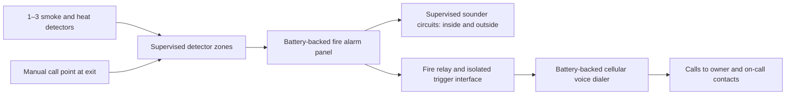

# Fire and smoke detection, automatic warning calls and audible alarms

Prepared for Hormuz Data Center, Ilam Province, Iran, on 13 October 2026. Prices are in **Iranian tomans (IRT); 10 IRR = 1 IRT**. This is a procurement and installation proposal for the existing **4.5 m × 4 m, four-rack room**, subject to a site survey.

## Recommendation

Buy **two conventional combined photoelectric-smoke/heat detectors for the rack room**, a battery-backed fire alarm control panel, **two wired sounder/beacons**, a manual call point and a cellular voice dialer. Add a **third detector in an adjacent UPS/electrical room** if the survey supports that placement. The three-detector installed planning budget is **73,083,600 IRT including 20% contingency, before tax**. The two-detector equivalent is **71,464,800 IRT**.

The fire panel is the primary monitoring system: it watches detector and sounder circuits, displays alarm/fault status, latches fire alarms and operates the sounders. Its fire relay triggers the dialer to call nominated people and play a recorded warning. Detection and local sound continue without the LAN, monitoring VM, Internet or cloud service. Cellular calls depend on the mobile network and dialer power.

Use genuine **ZITEX ZI-HSD 1015** combined detectors, with compatible bases. The manufacturer describes photoelectric smoke sensing and heat sensing; obtain written confirmation that the supplied version alarms on **smoke or heat**, without requiring both. Do not substitute heat-only sensors for early smoke warning, or confuse CO/gas detectors with smoke detectors. [Manufacturer detector description](https://www.zitexiran.com/en/heat-smoke-detector-zihsd1015/).

This scope provides warning, not extinguishing or guaranteed very-early detection. A competent local fire-alarm installer must confirm the design and applicable local requirements. Separate battery rooms, cable voids, escape routes and other building spaces may require additional detection. The proposed large UPS battery bank is not fully protected merely by adding one detector. Where strong airflow prevents reliable point detection, obtain a separate aspirating-smoke-detection design and quotation. [Hochiki air-sampling detector overview](https://www.hochikieurope.com/product/firelink-aspirating-smoke-detection).

## Choose the detector count and locations

Use the room coordinates from the [airflow proposal](airflow-proposal.md): southwest corner `(0,0)`, x along the 4.5 m side and y along the 4 m side. Racks occupy y=1.60–2.80 m; the planned contained hot aisle occupies y=2.80–4.00 m. The ceiling height and actual containment remain unconfirmed.

| Quantity | Proposed placement | Conditions and limits |
| --- | --- | --- |
| 1 | At the center of an open, unobstructed ceiling, approximately `(2.25, 2.00)` m | Only consider for a single open room with no separate containment or smoke pockets and an installer-approved airflow survey. The rack row/ducts may obstruct this point. One detector is not the recommendation for the planned contained layout. |
| **2 recommended** | D1 on the unobstructed ceiling over the general/cold-side room, initial candidate `(2.25, 0.60)` m; D2 at the highest smoke-collecting surface **inside** the contained hot aisle, initial candidate `(2.25, 3.40)` m | These are search areas, not drilling coordinates. Move them after checking supply/return openings, ducts, beams and containment. If the aisle has its own roof, mount D2 beneath that roof, rather than above it outside the enclosure. |
| 3 | Keep D1/D2; place D3 centrally on the ceiling of the adjacent UPS/electrical room, away from ventilation jets | Survey that room separately. If no such room exists, use D3 for a surveyed additional smoke pocket in the rack room. Do not mount it directly over a battery vent or assume one device covers every battery enclosure. |

As preliminary siting rules, keep detector centers **at least 0.5 m from walls/major obstructions and 1 m from supply-air inlets**, and outside direct ventilation jets. Check the actual model's mounting instructions and locally adopted rules. D2's narrow aisle and overhead return duct may make these clearances impossible at the candidate point: revise the duct/containment layout or select engineered air-sampling detection, rather than installing in an unsuitable location. A normal room detector must not simply be placed inside a duct.

The [Hochiki siting guide](https://www.hochikieurope.com/guides/BS5839_GUIDE_(V18_MAR18).pdf) discusses these clearances, obstruction effects and alarm audibility. It explains the 2017 BS5839 edition; it is guidance, not a claim of compliance with current Iranian requirements. Check smoke transport with cooling operating normally and at maximum duty. A successful aerosol test at the detector proves device operation, not that smoke from every rack will reach it promptly.

Mount the panel and dialer in an accessible, protected location near the entrance, preferably outside the rack room. Put one sounder/beacon inside the room and one outside at the entrance/operator approach, on separate supervised sounder circuits if the supplied panel supports this. Measure audibility with doors shut and fans running; use **at least 65 dB(A) or 5 dB(A) above sustained background noise, whichever is greater**, as an initial acceptance target, subject to the installer's local design. Increase sounder quantity/output if this fails. A generic flashing beacon does not establish certified visual-alarm coverage.

## Parts, connections and monitoring behavior

The estimate uses **ZX-1800-12**, because a public local price is available. Twelve zones exceed this small project's needs. Ask for a cheaper supported 4-zone panel quotation with the same required outputs; revise the estimate only after compatibility is confirmed. The manufacturer's ZX-1800-N family specifies 24 V operation, two 12 V 7.2 Ah batteries, a voltage-free auxiliary relay and 6.8 kΩ end-of-line resistors. The exact ordered panel revision and its manual govern wiring. [Manufacturer panel specifications](https://www.zitexiran.com/en/conventional-control-panel-zx1800n/).

1. Have the installer put D1, D2 and D3 on separately labeled zones where practical: `Rack room`, `Hot aisle`, `UPS room`. Put the manual call point near the exit on another zone. Use compatible two-wire conventional devices, correct polarity, routed zone wiring and an end-of-line device **at the last field device**, not left inside the panel. Terminate unused circuits as the manual requires. Detector removal, cable breaks and shorts must produce the specified local fault indications.
2. Connect the **24 V fire-rated sounder/beacons** to the panel's supervised sounder outputs. Observe polarity, current limits, required end-of-line components and voltage drop. These detectors are not standalone audible alarms; the separate sounders are essential. Budget 60 m of 2 × 1.5 mm² fire-alarm cable across all routes, with metal supports, conduit where needed and penetration firestopping. Measure routes before ordering.
3. Connect the panel's fire relay through a documented isolated interface to the dialer's trigger input. Confirm contact rating, trigger polarity, latching behavior and reset behavior on the bench. **Do not feed a 24 V sounder output into a 12 V dialer input.** Keep the trigger cable short and protected. The basic dry-contact dialer link may be unsupervised; prove operation regularly and request a supervised communicator if remote transmission supervision is required.
4. Power the panel from a dedicated protected mains circuit with its own charger and two matched 12 V batteries in series. Power the dialer from a separate fused, battery-backed 12 V charger supply. **Do not tap the midpoint of the panel batteries.** The budget includes a dialer PSU/charger, battery, enclosure and antenna allowance. Verify that the charger can support both standby consumption and cellular transmit peaks.
5. Use a dialer supporting recorded **voice messages**, calls to at least three numbers and configurable retries. **N1 is a procurement candidate**, publicly listed at 6,499,000 IRT; its seller advertises calls with recorded-message playback. Obtain the actual manufacturer's manual and prove these functions before accepting this model. Confirm supported cellular bands and voice service with the local operator; an LTE/data label alone does not establish usable voice calls. [N1 price and advertised functions](https://negahbansystem.ir/fa/Home-alarm/1696-gsm-dialer-n1-fire-alarm.html).

Configure fire detection **24 hours a day**, independent of any burglary arming state. A single detector or call-point alarm must sound locally and start calls immediately; do not wait for a second detector or human confirmation. Sounder silence must not clear the fire relay prematurely. Reset only after an authorized person checks the cause.

Record a Persian warning giving the site name, full address and response instruction, for example: “Fire alarm at Hormuz Data Center, [full address]. Evacuate anyone present and contact the on-call operator immediately.” Call the owner, primary on-call operator and backup operator. Request three call attempts per contact with a short retry interval; validate the supplied dialer's actual sequence and whether answering, voicemail or keypad acknowledgment changes escalation. If it cannot perform the agreed sequence, select another dialer. SMS can supplement calls. Do not program automatic calls to public emergency numbers without an approved arrangement.

The baseline is **self-monitoring**, not a staffed alarm-receiving-center contract. Call acceptance is not proof someone will respond; nominate an operator and backup with an agreed escalation procedure. Local panel faults require daily inspection; this budget does not promise remote fault reporting. If that is needed, specify a panel/communicator with documented separate fire, fault and communication-failure reporting.

The existing [rack monitoring VM](rack-monitoring-proposal.md) may later receive separate fire/fault relay status through an isolated network I/O module. That optional dashboard interface is excluded here, and must neither carry nor delay the primary siren/call path. Coordinate hardwired door unlocking with the [security proposal](security-proposal.md); its separately budgeted release interface must operate while UPS power remains available. Do not add automatic server shutdown or cooling shutdown without an engineered cause-and-effect design.

## Buying and installation sequence

1. **Survey and quotation:** book a local fire-alarm installer; confirm the ceiling, air paths, containment, adjacent electrical room, existing fire panel, mains feed, cellular reception and alarm audibility. If a compatible building fire panel already exists, quote adding supervised zones and the dialer instead of buying a duplicate panel. The table below assumes a new panel because the existing panel assumed by the security proposal has not been verified.
2. **Order as a matched package:** request the detectors with bases, panel, sounders, call point, batteries, dialer/manual, power supplies, interfaces and cable. Obtain model numbers, compatibility confirmation, authenticity/warranty documentation, current local acceptance documents and a written price including tax and delivery. Confirm whether detector bases, batteries, antenna, EOL devices and mains protection are already included to avoid double charging.
3. **Bench check:** demonstrate smoke and heat alarm behavior, relay-to-dialer triggering, recorded voice playback and contact escalation before mounting. Save configuration and label circuits.
4. **Install:** the specialist runs protected cabling, mounts equipment, connects mains and batteries, documents circuit loads and battery sizing, and produces a zone plan and terminal drawing. The owner supplies contact numbers/address and reviews the response procedure. Allow about **2–3 working days after delivery**, including survey/commissioning, if routes are simple.
5. **Commission and hand over:** complete the checks below, then record a 72-hour observation period for nuisance alarms and power/communication stability. Leave manuals, as-built drawings, battery calculations, test records, zone map and reset/silence instructions with the operator.

For preliminary backup sizing, request **24 hours standby plus 30 minutes alarm**, or the greater local requirement. For each supply separately, calculate `required Ah = 1.25 × (standby A × 24 h + alarm A × 0.5 h)` from measured/OEM loads, then apply battery temperature, ageing and discharge corrections and check charger/enclosure capacity. Two series 7.2 Ah batteries give **24 V at 7.2 Ah**, not 14.4 Ah. The priced batteries are starting allowances, not a demonstrated autonomy result; resize if the calculation fails.

| Acceptance check | Required evidence |
| --- | --- |
| Smoke and heat | Every detector tested with manufacturer-approved aerosol/heat equipment; correct zone, latched alarm, both sounders and warning call demonstrated. Never use an open flame. |
| Manual alarm | Call point starts the same local/call response; reset works only as documented. |
| Audible coverage | Recorded sound levels at working positions and outside the closed door with cooling at maximum normal duty. |
| Calling | All three contacts receive intelligible address/message; unanswered calls and voicemail are tested; actual retry behavior is recorded. Aim for first call initiation within 30 seconds of panel alarm, as a commissioning target rather than a network delivery guarantee. |
| Faults | Detector removal, zone/sounder open circuits and safe simulated shorts produce the manual's expected fault response; restoration is shown. Confirm one sounder circuit fault leaves the other operating. |
| Outages | Disconnect Internet/LAN: local sound and cellular calls still work. Remove mains: panel and dialer operate on their batteries. Verify calculations and a controlled backup test. Remove SIM/network service: local alarm still operates and the communication limitation is visible/documented. |
| Building interface | Existing door fire-release interface tested on UPS power; any additional fire controls follow an approved cause-and-effect schedule. |

Inspect the panel's normal/fault state daily; check SIM balance/expiry and perform a scheduled test call monthly. Arrange periodic functional tests, cleaning and battery capacity checks with the installer at the manufacturer's/local required intervals. Log impairments and provide temporary coverage when circuits are isolated. Cellular network failure, SIM suspension and a failed dialer can prevent calls while local alarms still work.

## Cost estimate and summation

Local list prices below are from the [Asafire June 1405 ZITEX list](https://asafire.ir/zitex-price-list); they are historical list-price references found on 13 October 2026, **not current stock reservations or binding quotes**. Discounted listings also exist; no discount is assumed. N1 uses its opened seller page price, explicitly before tax. All remaining rows are clearly marked planning allowances. No foreign-exchange conversion is needed.

| ID | Part/service | Quantity | Unit IRT | Line IRT | Price basis |
| --- | --- | ---: | ---: | ---: | --- |
| F01 | ZI-HSD 1015 smoke/heat detector | 3 | 1,199,000 | 3,597,000 | Asafire list |
| F02 | Compatible detector base allowance | 3 | 150,000 | 450,000 | Allowance; remove if included with F01 |
| F03 | ZX-1800-12 conventional fire panel with charger | 1 | 20,900,000 | 20,900,000 | Asafire list; seek smaller compatible panel quote |
| F04 | ZI-SS 81 sounder/beacon | 2 | 1,099,000 | 2,198,000 | Asafire list; confirm 24 V compatibility |
| F05 | ZI-CP 95 manual call point and test key | 1 | 1,059,000 | 1,059,000 | Asafire list |
| F06 | Panel battery, matched 12 V 7.2 Ah VRLA | 2 | 1,800,000 | 3,600,000 | Allowance; verify required capacity |
| F07 | N1 cellular recorded-voice dialer candidate | 1 | 6,499,000 | 6,499,000 | [Seller price](https://negahbansystem.ir/fa/Home-alarm/1696-gsm-dialer-n1-fire-alarm.html); acceptance conditional on manual/test |
| F08 | Dialer 12 V PSU/charger, fuse, enclosure and antenna | 1 set | 2,500,000 | 2,500,000 | Allowance; sized for transmit peaks |
| F09 | Dialer 12 V 7.2 Ah VRLA battery | 1 | 1,200,000 | 1,200,000 | Allowance; verify capacity and quoted price |
| F10 | Isolated fire-relay trigger interface and protected lead | 1 set | 1,500,000 | 1,500,000 | Allowance; exact circuit follows manuals |
| F11 | Fire-alarm cable, 2 × 1.5 mm² | 60 m | 60,000 | 3,600,000 | Allowance; route/specification survey required |
| F12 | Metal supports, conduit, boxes, labels, glands, firestopping and EOL parts | 1 lot | 2,000,000 | 2,000,000 | Allowance; EOL specification follows panel manual |
| F13 | Protected mains feed, isolator and termination | 1 set | 1,500,000 | 1,500,000 | Allowance; electrician |
| F14 | SIM activation and initial voice/SMS credit | 1 | 800,000 | 800,000 | Allowance; select operator after coverage test |
| F15 | Domestic delivery | 1 | 1,000,000 | 1,000,000 | Allowance |
| F16 | Specialist installation | 1 service | 6,000,000 | 6,000,000 | Allowance |
| F17 | Commissioning, test-equipment use and operator training | 1 service | 2,500,000 | 2,500,000 | Allowance; includes installer aerosol/heat and sound-level tests |
| | **Installed subtotal** | | | **60,903,000** | Sum F01–F17 |
| | **Contingency, 20%** | | | **12,180,600** | 0.20 × subtotal |
| | **TOTAL: three detectors, installed before tax** | | | **73,083,600 IRT** | Subtotal + contingency |

All itemized costs and quantity scenarios are included in this document. Holding the panel, sounders, cable and labor allowances constant, changing only detector/base quantity gives:

| Installed detector count | Subtotal IRT | 20% contingency IRT | Total before tax IRT |
| --- | ---: | ---: | ---: |
| 1, only for an approved open-room layout | 58,205,000 | 11,641,000 | **69,846,000** |
| **2, recommended rack-room starting scope** | **59,554,000** | **11,910,800** | **71,464,800** |
| 3, adds surveyed adjacent-room detection | 60,903,000 | 12,180,600 | **73,083,600** |

Recurring costs are planning allowances, not published tariffs. Replace them with actual operator and maintenance quotations; battery replacement is a separate future cost.

| Recurring item | Quantity per year | Unit IRT | Annual IRT | Basis |
| --- | ---: | ---: | ---: | --- |
| SIM voice/SMS service | 12 months | 200,000 | 2,400,000 | Planning allowance; separate from initial SIM activation/credit |
| Inspection and functional testing | 1 service | 3,000,000 | 3,000,000 | Planning allowance |
| **Annual recurring subtotal** | | | **5,400,000** | Sum of annual service allowances |

| Three-detector first-year summation | IRT |
| --- | ---: |
| Installed subtotal | 60,903,000 |
| Installation contingency, 20% | 12,180,600 |
| **Installed total before tax** | **73,083,600** |
| Annual recurring subtotal | 5,400,000 |
| **First-year total before tax** | **78,483,600** |

Excluded: tax, a staffed monitoring contract, new UPS/network infrastructure, optional VM integration, major containment/duct/civil changes, full building or large battery-room coverage, additional sounders/batteries after engineering checks, aspirating detection, suppression and new door-release hardware already budgeted in the security proposal. Reconcile shared interfaces between quotations. The **73,083,600 IRT** installation total pays for the specified parts and services; contingency does not fund excluded scope.

## One-page summary

**Recommended decision:** install two combined smoke/heat detectors for the 18 m² rack room, with a third for an adjacent UPS/electrical room if a survey supports it. Any detector or manual call-point alarm immediately activates local sounders and triggers recorded warning calls to the owner, on-call operator and backup contact.

| What to buy | Quantity and purpose |
| --- | --- |
| ZITEX ZI-HSD 1015 detectors and compatible bases | 2–3; detect smoke or heat, with alarm behavior confirmed before purchase |
| Compatible conventional fire panel | 1; estimate uses ZX-1800-12; seek a smaller supported panel quote |
| ZI-SS 81 sounder/beacons and ZI-CP 95 call point | 2 sounders, inside/outside the entrance; 1 manual call point at the exit |
| Panel backup batteries | 2 matched 12 V 7.2 Ah batteries in series; verify required autonomy |
| Cellular recorded-voice dialer and isolated trigger interface | 1 each; N1 is a candidate subject to manual review and call testing |
| Dialer backup supply | Separate 12 V PSU/charger, battery, fuse, enclosure, antenna and active SIM |
| Installation materials/services | Approximately 60 m fire-alarm cable, supports, conduit, EOL parts, protected mains feed, installation and commissioning |

**Placement:** D1 goes on an unobstructed ceiling over the general/cold-side room; D2 goes beneath the highest smoke-collecting surface inside the contained hot aisle. D3, if used, goes in the surveyed adjacent electrical room. Avoid direct ventilation jets; initially allow 0.5 m from walls/major obstructions and 1 m from supply inlets. Final locations require installer review of ducts, containment and airflow. One detector is only an option for an approved open-room layout. If smoke cannot reliably reach point detectors, obtain a separate air-sampling design.

**What to do:** obtain a site survey and matched-package quotation; confirm detector/panel compatibility and cellular voice coverage; bench-test the relay, dialer message and retries; then have a specialist install and label the supervised circuits. Allow 2–3 working days after delivery plus a 72-hour observation period. Commission every detector and call point, test sound levels with fans running and doors shut, confirm calls reach all contacts, and demonstrate battery operation and circuit-fault indications. Record the site address in the Persian warning message.

| Budget option | Total IRT before tax |
| --- | ---: |
| 1 detector, approved open-room layout only | 69,846,000 |
| **2 detectors, recommended rack-room scope** | **71,464,800** |
| 3 detectors, including surveyed adjacent-room detection | 73,083,600 |
| Annual SIM and inspection/testing allowance | 5,400,000 |
| **3-detector first-year total** | **78,483,600** |

Installed totals include 20% contingency; prices are planning references and allowances requiring fresh quotations. Detection and local sound operate without Internet/LAN; warning calls require working cellular service and dialer power. Check panel status daily and SIM credit/expiry and test calls monthly. This scope provides warning; suppression, staffed monitoring, full building/battery-room coverage, optional VM integration and major construction changes are excluded.
