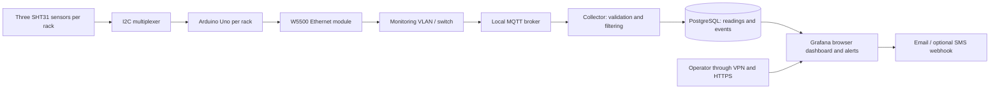

# Four-rack temperature and humidity monitoring proposal

Prepared for Hormuz Data Center on 13 October 2026. All financial totals are in Iranian tomans (IRT). Price checks are indicative, not supplier quotations.

## Recommendation and scope

Build **four Arduino Uno R3 nodes, one per rack, with three combined temperature/relative-humidity sensors per rack**: 12 installed sensing points. Connect each node by wired Ethernet to an existing local Linux VM that records readings and serves a Grafana dashboard. Send notifications through email, with an optional Iranian SMS gateway for escalation.

Allow **44,782,200 IRT for hardware and materials, including spares and 20% contingency**. One person with Arduino and Linux experience should allow **80–112 working hours**, usually **3–4 calendar weeks including installation and a 72-hour observation period**, after parts arrive. At an illustrative labor rate of 500,000 IRT/hour, the installed project is **84,782,200–100,782,200 IRT**, excluding recurring service costs.

“Moisture” is assumed to mean **air relative humidity (%RH)**. Humidity sensors do not detect water on the floor. Leak probes or sensing cable should be added separately if that is required. This proposal covers monitoring, logging, visualization and notifications; automatic cooling control is a separate project.

The estimate assumes four rack network ports, an existing Ethernet switch, UPS-backed rack outlets, an existing Linux VM, a backup destination, Internet connectivity and basic electronics tools. These prerequisites must be confirmed in the site survey.

## Sensor placement and controller choice

Use one SHT31-D module at each rack's lower, middle and upper **front air inlet**, approximately at the heights of the equipment intakes. Each module measures both temperature and humidity; separate pairs of devices are unnecessary. Keep sensors in ventilated holders, away from controller heat, direct contact with metal and exhaust air. Label them `R01-bottom`, `R01-middle`, `R01-top`, and similarly for the other racks.

This placement is an engineering recommendation to reveal vertical hot spots. Start with two points per rack if cost is the priority, then add the third. A fourth point at the rear can measure exhaust temperature, but must have separate thresholds and labels; it must not be averaged into inlet alarms.

SHT31 is a suitable starting choice because it provides factory-calibrated digital readings and typical humidity accuracy of ±2%RH. Use a conservative planning temperature accuracy of approximately ±0.3°C and confirm the exact purchased variant against its datasheet. Installation and module quality can increase practical measurement error. [Sensirion SHT31 product specifications](https://sensirion.com/products/catalog/SHT31-DIS-B), [Sensirion SHT3x datasheet](https://sensirion.com/media/documents/213E6A3B/63A5A569/Datasheet_SHT3x_DIS.pdf).

An **Uno is sufficient for sampling and sending three sensor readings**, provided storage, heavy filtering, HTTPS and the user interface run on the VM. Its 2 KB SRAM makes it unsuitable for hosting this complete application. By “Duo,” this proposal assumes **Arduino Due**: it provides more memory and processing capacity, but operates with 3.3 V logic and still needs a network interface. It brings little benefit for three slow sensors per rack. Verify all module voltage compatibility if an existing Due kit is used. [Arduino Uno specifications](https://docs.arduino.cc/hardware/uno-rev3/), [Arduino Due datasheet](https://docs-content.arduino.cc/resources/datasheets/A000062-datasheet.pdf).

One central Uno is possible on a bench, but would require long sensor wiring between racks and create a common failure point. Four local nodes make rack expansion and replacement easier.

## Architecture and wiring

Repeat the rack hardware four times; the local VM hosts the common software. The W5500 provides Ethernet and TCP/IP over SPI. Select a complete module with RJ45, magnetics and an onboard regulator suitable for a 5 V supply; the chip itself requires 3.3 V. Do not try to power its roughly 128 mA module load from the Uno's limited 3.3 V output. [WIZnet W5500 documentation](https://docs.wiznet.io/Product/Chip/Ethernet/W5500), [ECA W5500 module](https://eshop.eca.ir/ماژول-شبکه-و-wifi/10821-ماژول-شبکه-w5500-دارای-ارتباط-spi.html).

Per rack:

1. Connect Uno A4/SDA and A5/SCL to a TCA9548A multiplexer, with a common ground and voltage-compatible supply/pull-ups. Connect the three sensors individually to channels 0, 1 and 2. Enable only one channel at a time, so identical sensor addresses do not collide. SHT31 offers addresses 0x44 and 0x45; three devices need the multiplexer. For the two-sensor economy option, buy modules exposing the address-select pin and set those two addresses. [Sensirion address specification](https://sensirion.com/media/documents/213E6A3B/63A5A569/Datasheet_SHT3x_DIS.pdf), [Adafruit multiplexer operation](https://www.adafruit.com/product/2717).
2. Connect the W5500 to Uno SPI: D11/MOSI, D12/MISO, D13/SCK and D10/chip select. Wire reset as required by the actual module and verify its supply pins before applying power. Configure unique MAC addresses and reserved IP addresses.
3. Mount the controller near the middle of the rack. Aim for sensor branches no longer than about 1 m, use SDA/ground and SCL/ground pairs, start at 100 kHz, and check pull-up resistance and waveform quality using the actual harness. **A multiplexer solves address conflicts; it does not make I2C a long-distance bus.**
4. If a branch is unreliable, shorten it or use a qualified I2C extender/additional local node. Longer rack runs should use an industrial RS-485 sensor design. Those changes require a revised parts budget and schedule.
5. Feed each node through its USB power input from a regulated 5 V adapter on the rack UPS. Use soldered assembly, strain relief, labeled connectors and enclosed electronics for installation; breadboards are for the bench prototype.

## Measurement, filtering and recording

The following are proposed implementation settings, to be adjusted during commissioning:

- Sample all sensors every **10 seconds** using a timed, nonblocking loop. Check sensor CRC, reject failed/nonfinite readings and physically impossible values, and report quality flags. A failed read must never be converted to zero or a previous value presented as current.
- Send raw readings and status to `hormuz/racks/R01/telemetry` and equivalent rack topics. Include node ID, position, boot/session ID, sequence number, uptime, temperature, %RH and firmware version. Use fixed-size buffers on the Uno. Ordinary MQTT QoS 0 telemetry is adequate for this baseline if sequence gaps are recorded; it does not guarantee delivery.
- The collector timestamps reception in UTC with an NTP-synchronized VM clock. Preserve uptime and sequence numbers to detect delay/restarts. Store raw valid readings, invalid-read events and the filtered values. Expose freshness explicitly; do not retain telemetry as though it were a fresh measurement after restart.
- For each sensor independently, compute a median of the latest **three valid 10-second samples**, then an exponential moving average with `alpha = 0.3`. Reset the filter after a prolonged gap rather than smoothing old data into a new session. Save the processing version and any calibration offsets. Filtering removes noise; it cannot correct a biased sensor.
- Use smoothed values for trends and ordinary warning rules. Use valid raw readings for a faster critical rule, so smoothing cannot hide a sharp temperature rise. Do not reject a valid rapid rise merely because it is large.
- Preserve 10-second raw/filtered readings for **30 days**, and 5-minute minimum/maximum/mean/count aggregates for **12 months**. Preserve alert events for at least a year. The raw stream is about **3,110,400 sensor records per 30 days** for 12 points. Start the VM with 2 vCPU, 4 GB RAM and 40 GB disk, then measure actual storage usage during the pilot. Back up daily to another system and test a restore.

Use Mosquitto for MQTT, a small Python collector, PostgreSQL for storage and Grafana OSS for the interface. Grafana has a built-in PostgreSQL data source and notification integrations including email, Telegram and webhooks. An Iranian SMS API would be connected through a small webhook adapter; it requires a provider account and delivery testing. [Grafana PostgreSQL support](https://grafana.com/docs/grafana/latest/datasources/postgres/), [Grafana notification contact points](https://grafana.com/docs/grafana/latest/alerting/fundamentals/notifications/contact-points/).

## Online interface and notifications

Provide four rack overview cards showing maximum inlet temperature, humidity range, worst sensor status and last update. Include per-position readings, temperature/humidity histories, alert history and CSV export through the dashboard. Provide viewer and administrator access, with configurable thresholds and maintenance silences.

These are **initial commissioning examples**, not equipment operating limits or a claim of standards compliance. Set final limits from the installed server manufacturers' requirements and the site's agreed operating policy.

| Condition | Initial example | Proposed behavior |
| --- | --- | --- |
| Warm inlet | Filtered temperature >27°C for 2 minutes | Email warning |
| Critical inlet | Valid raw temperature >32°C twice consecutively | Urgent email and optional SMS |
| Humidity outside operating policy | Filtered RH <30% or >65% for 5 minutes | Warning |
| Sensor failure | Three consecutive invalid reads | Sensor fault notification |
| Missing node/sensor | No fresh valid reading for 60 seconds | Offline/stale notification |
| Recovery | Temperature below trigger minus 2°C; humidity back inside limits by 3 percentage points, for 5 minutes | Recovery notification |

Evaluate rules every 10 seconds. With two raw samples plus evaluation/delivery, target critical notification within **45 seconds of the measured threshold crossing**, excluding the sensor's physical response and external provider delays. Group notifications by rack; repeat unresolved critical alerts every 15 minutes and warnings every hour. Record firing, delivery failure and recovery events. Add an operator response procedure and an external heartbeat check for the monitoring VM, since a failed VM cannot report its own failure.

Keep the broker on an isolated monitoring VLAN with per-node credentials and topic permissions. Uno-to-broker traffic is unencrypted within that restricted network; do not expose that listener to the Internet. Use VPN and HTTPS for remote dashboard access. Store notification credentials on the VM. Mosquitto supports authentication and access-control configurations. [Mosquitto authentication documentation](https://mosquitto.org/documentation/authentication-methods/).

During an **Internet outage**, local sampling, storage, dashboard and alert evaluation continue; external notifications may fail and need retry/expiry handling. During a **rack LAN or VM outage**, the baseline has no durable storage on the Uno, so readings can be lost. Record gaps explicitly. If lossless outage recording is required, add SD storage and RTC to every node, sequence-based replay and duplicate suppression, or choose a controller with more memory. Historical replay must not trigger fresh critical notifications. This option is not included in the baseline budget.

## Financial estimate

Use **1 USD = 270,000 IRT**, exactly as requested. Iranian rial prices are divided by **10** to obtain IRT. Local Persian product pages below were opened during research; their prices were higher than the older search summaries, so the opened page prices are used. Availability is the displayed status, not a reservation. No quantity discounts are assumed.

| Item | Quantity | Source price per unit | Unit IRT | Line IRT | Basis |
| --- | ---: | ---: | ---: | ---: | --- |
| Uno R3 CH340 | 5 | 7,740,000 IRR | 774,000 | 3,870,000 | [ECA, in stock](https://eshop.eca.ir/بردهای-خانواده-آردوینو-arduino/3975-برد-آردوینو-arduino-uno-ch340.html); 4 installed + 1 spare |
| SHT31-D module | 14 | 6,200,000 IRR | 620,000 | 8,680,000 | [ECA, in stock](https://eshop.eca.ir/ماژول-دما-و-رطوبت/5330-ماژول-سنسور-دما-و-رطوبت-sht31-d.html); 12 installed + 2 spares |
| W5500 Ethernet module | 4 | 10,200,000 IRR | 1,020,000 | 4,080,000 | [ECA, in stock](https://eshop.eca.ir/ماژول-شبکه-و-wifi/10821-ماژول-شبکه-w5500-دارای-ارتباط-spi.html) |
| TCA9548A multiplexer | 4 | $6.95 | 1,876,500 | 7,506,000 | [Adafruit USD fallback](https://www.adafruit.com/product/2717); no verifiable Persian price found |
| 5 V USB adapter, CY-0530 rated 3 A | 4 | 9,500,000 IRR | 950,000 | 3,800,000 | [ECA, in stock](https://eshop.eca.ir/آداپتور/10738-آداپتور-5-ولت-3a-با-خروجی-usb-مدل-cy-0530.html); verify voltage and actual load performance |
| USB power/programming cables | 5 | $0.75 allowance | 202,500 | 1,012,500 | Planning allowance, not a supplier price |
| Controller enclosures | 4 | $2.00 allowance | 540,000 | 2,160,000 | Planning allowance |
| Perfboard, terminals, headers, protection and decoupling | 4 sets | $1.50 allowance | 405,000 | 1,620,000 | Planning allowance |
| Sensor harnesses, ventilated mounts, ties and labels | 4 sets | $2.00 allowance | 540,000 | 2,160,000 | Planning allowance; short branches |
| Ethernet patch cables | 4 | $1.50 allowance | 405,000 | 1,620,000 | Planning allowance; existing switch ports |
| Domestic shipping | 1 | $3.00 allowance | 810,000 | 810,000 | Planning allowance |
| **Materials subtotal** | | | | **37,318,500** | |
| **Contingency: 20% of materials** | | | | **7,463,700** | Price movement and small omissions |
| **Hardware/materials budget** | | | | **44,782,200** | Approximately **44.8 million IRT** |

The USD multiplexer price is a product-price fallback, not a delivered Iranian quote. International freight, import fees and local reseller markup are excluded; the domestic shipping line does not cover them. Prefer a locally sourced compatible multiplexer after getting a firm quote. The contingency may not cover importing four branded boards. All unquoted ancillary rows are explicit budgeting assumptions converted from USD, rather than researched market prices. Tax treatment is whatever the displayed local retail price includes; additional checkout taxes are not separately estimated.

For a lower starting cost, install **two sensors per rack**, keep the same two spare sensors and spare Uno, and omit the multiplexers. With address-selectable modules and otherwise identical allowances, the budget becomes **32,799,000 IRT including contingency**. It sacrifices middle-height coverage. Four points per rack add four sensors and produce a minimum budget of **47,758,200 IRT including contingency**; longer rear wiring or additional mounts may increase it.

### Labor, recurring costs and prerequisites

The illustrative labor rate is **500,000 IRT/hour**, an assumption for comparing the project cost, not a researched Iranian wage or contractor quote. At 80–112 hours, labor costs **40,000,000–56,000,000 IRT**. If you perform the work yourself, cash expenditure can be limited to materials and service charges, but your time remains the same.

| Scenario | One-time IRT |
| --- | ---: |
| Recommended hardware, existing infrastructure, self-built | 44,782,200 |
| Recommended hardware plus illustrative paid labor | 84,782,200–100,782,200 |
| Economy hardware, existing infrastructure, self-built | 32,799,000 |

The baseline uses existing infrastructure and the OSS software editions; there is no new software license purchase. For recurring budgeting, reserve **$2/month = 540,000 IRT/month** for backup storage and **$2/month = 540,000 IRT/month** for email/SMS usage: together **1,080,000 IRT/month**, or **12,960,000 IRT/year**. These are allowances, not provider tariffs; SMS usage, sender registration and API access require a quote. Existing backup/email services could reduce this incremental cost.

Allow **2–4 hours/month** for checks, updates, restore exercises and inspecting probes: **1–2 million IRT/month** at the illustrative labor rate. First-year hardware plus service allowances is **57,742,200 IRT** for a self-build; adding setup and maintenance labor gives **109,742,200–137,742,200 IRT**. Electricity and the opportunity cost of the existing VM are excluded.

If prerequisites are absent, provisional USD allowances are: a small Linux host with storage and power supply **$100 = 27,000,000 IRT**, a suitable switch **$30 = 8,100,000 IRT**, and basic tools **$30 = 8,100,000 IRT**. These are unquoted placeholders, outside the baseline. Obtain local specifications and prices before replacing them with purchase decisions. UPS capacity, independent outage notification hardware, leak detection, certified calibration, new Internet service and durable node logging are also outside the baseline and must be scoped separately if needed.

## Procedure and one-person schedule

| Step | Work and completion evidence | Hands-on hours |
| --- | --- | ---: |
| 1. Site survey and design | Map intake points, measure cable runs, confirm ports/UPS/VM, set retention and notification recipients; produce a wiring plan and final shopping list | 6–8 |
| 2. One-rack bench prototype | Buy/test one Uno, three probes, mux and Ethernet module; verify power and actual cable harness, compare probes side by side | 10–14 |
| 3. Firmware | Implement timed reads, CRC/status, channel selection, unique IDs, sequence/boot tracking, network reconnect and watchdog; inspect SRAM/flash usage | 18–24 |
| 4. Backend and records | Configure broker access, collector, schema, filters, retention, backups and automatic service restart; confirm correct timestamps and gap handling | 14–20 |
| 5. Interface and alerts | Build rack views/history/export, thresholds, stale/fault rules, email and notification templates; test from the intended remote access path | 10–14 |
| 6. Build and installation | Assemble/enclose four nodes, label harnesses, install sensor holders and rack network/power connections | 10–14 |
| 7. Commissioning | Run failure and threshold tests, observe for 72 hours, tune settings and compare sensors with a trusted reference | 8–12 |
| 8. Handover | Save firmware/configuration, inventory, operating procedure, restore instructions and replacement instructions | 4–6 |
| **Total** | | **80–112** |

At eight productive hours/day this is **10–14 working days**. Plan roughly **3–4 calendar weeks after parts arrive** to allow sequencing, rack access and a 72-hour unattended soak; the soak is elapsed time, with its active checks counted above. Procurement may add **1–2 weeks or longer**, especially for the USD fallback part. At about four hours/day, expect **5–7 weeks**. A beginner should allow approximately **160–220 hours**, often **6–8 full-time calendar weeks plus procurement**.

Start with one rack and establish the full sensor-to-notification path before assembling the remaining three. Use the pilot to decide whether two or three inlet points are sufficient and whether the short I2C harness is dependable.

### Commissioning acceptance criteria

- All 12 installed positions report every 10 seconds, with correct rack/position mapping and clear stale/fault status. Compare probes side by side and against a trusted reference after stabilization; investigate differences greater than roughly 0.5°C or 3 percentage points RH, accounting for reference uncertainty. This is a functional comparison, not certified calibration.
- A controlled sensor stimulus or injected test data produces warning, critical and recovery events. Verify actual email receipt and, if enabled, SMS receipt; a dashboard event alone does not demonstrate delivery.
- Unplug a probe and a rack Ethernet cable separately. Confirm fault/stale notification and that old readings are not shown as current. Reconnect and verify recovery and recorded gaps.
- Disconnect Internet while keeping the LAN running. Confirm local recording continues and failed notification attempts are visible. Reboot the node and VM separately; confirm automatic restart, boot identification and correct timestamps.
- Verify a threshold spike remains visible in raw records and exercises the critical path. Test hysteresis, maintenance silence and repeat suppression so one incident does not generate an alert storm.
- Complete a 72-hour run with no unexplained resets or gaps, export a history slice, and restore a backup into a separate database. Record all findings before operational handover.

Keep the wiring map, purchased module variants, firmware versions and notification settings with the project. Inspect connectors and dust periodically, compare probes every six months and after suspected drift, and retest alerts after changing software or service credentials.
