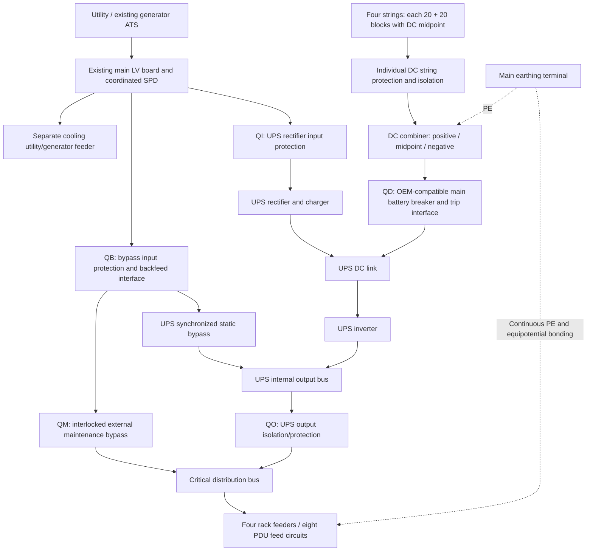

# Proposal: battery UPS for the 50 kW Hormuz mini data center

**Prepared:** 13 October 2026. **Site:** assumed Hormuz, Ilam Province, Iran. **Status:** preliminary engineering and budget proposal; not issued for construction. Currency is Iranian tomans (IRT), not rials. All design assumptions, calculations, runtime comparisons, itemized cost estimates, implementation steps and acceptance criteria are included in this single Markdown file.

## 1. Proposed result and decision

For a **50 kW critical load and 15-minute backup**, reserve an **80 kVA / 80 kW, 400/230 V, three-phase online double-conversion UPS** and space/budget for **160 batteries**, each **12 V, 50 Ah**, arranged as **four parallel strings of 40 blocks**. Each string has two equal 20-block halves where the selected UPS requires a DC midpoint. This is a planning quantity, not a verified runtime guarantee. The final battery count must pass the manufacturer's constant-power discharge selection described in section 5.

Use **stationary high-rate UPS batteries approved by the UPS supplier**. An automotive starter battery bank is evaluated below because it was requested, but it is not the proposed production installation. Starting batteries are designed for short high-current bursts and are unsuitable for repeated deep discharge; “sealed/maintenance-free” on an automotive label does not establish UPS compatibility. [Trojan battery application guidance](https://www.trojanbattery.com/resources/flooded-lead-acid/selecting-deep-cycle-flooded-batteries).

The planning installed total is **12,024,000,000 IRT** with stationary batteries, including 20% contingency, before tax and import duty. The automotive comparison is **11,448,000,000 IRT** on the same infrastructure basis. These are unquoted budget allowances, not supplier offers; section 10 explains the limited retail evidence and exclusions. The apparent saving of 576,000,000 IRT does not justify an unsupported battery application.

This base system has **one UPS and one common output board**. It provides battery ride-through, but has no UPS redundancy and no independent A/B power paths. A single string isolated leaves three strings and reduces the screening runtime below the design target. An optional fifth string (200 blocks total) can preserve four-string capacity when one string is unavailable, subject to OEM approval; it does not remove UPS or board failure points.

## 2. Design basis and information needed

“50 Ampere” is assumed to mean **50 ampere-hours (Ah) per battery**, at a stated discharge duration. Amperes measure current; Ah measures stored charge. A 50 Ah battery is not a promise of 50 A for one hour. If 50 A is instead a continuous battery current limit, see section 5. If it refers to the incoming AC supply, see section 4.

| Parameter | Design assumption | Required confirmation before purchase |
| --- | --- | --- |
| Critical AC load | 50 kW continuous at the UPS output | Log real kW, kVA, peak and per-phase load for at least one representative week |
| Backup duration | 15 minutes at 50 kW; 10% sizing time reserve | Owner's required shutdown time and generator start/retry time |
| Supply | 400 V line-to-line, 230 V line-to-neutral, 3-phase, 50 Hz | Utility voltage, contracted capacity, earthing arrangement, fault level |
| Critical load power factor | 0.90 | Measure rack power factor and harmonics |
| UPS capacity | 80 kVA and at least 80 kW after site derating | Selected product, altitude, temperature and overload envelope |
| Battery-mode conversion efficiency | 0.94, including a preliminary allowance for losses | OEM efficiency at the actual load and DC voltage; auxiliary consumption |
| Battery block | 12 V, 50 Ah at C20 assumed for automotive screening | Exact model, Ah rating duration, watts/block curves, impedance, charging and cycle data |
| Battery bus | 40 blocks; 480 V nominal end-to-end | OEM-supported series count and midpoint connection |
| Screening cutoff | 1.75 V/cell: 420 V end-to-end | OEM and battery-approved cutoff at this discharge rate |
| Age and temperature factors | 0.80 and 0.90 | Battery end-of-life policy and curves at minimum design temperature |
| Battery environment | Separate service space, controlled around 20–25°C | Actual room, exhaust path, fire compartment, floor capacity, clearances |
| Routes | 15 m each for three AC feeders; short battery routes | Measure routes; grouping, ambient temperature, terminal capacity |
| Currency | IRT; illustrative 270,000 IRT/USD retained from earlier site proposal | Written local quotes; this is not a verified October exchange rate |

The previous [airflow proposal](airflow-proposal.md) budgets a 20 kW example. It does not establish cooling capacity for this 50 kW IT case. Here **50 kW is the critical UPS load**, rather than confirmed total facility demand. Cooling compressors remain on a separately designed utility/generator feeder. Essential room circulation and controls need power continuity or a demonstrated thermal shutdown window. If these auxiliaries are added to this UPS, add their measured kW and motor starting demand and repeat every calculation. A 15-minute electrical runtime alone does not establish 15 minutes of safe server temperatures.

## 3. Standards and engineering deliverables

Use the applicable adopted editions and amendments, local Iranian wiring/fire requirements and utility rules. Catalog summaries were reviewed; the full paid standards were not audited clause by clause. This proposal does not claim statutory approval or certification.

| Reference | Application to this project |
| --- | --- |
| [IEC 62040-1, UPS safety](https://webstore.iec.ch/en/publication/31983) | Certified UPS assembly, isolation, backfeed protection and service access; confirm applicable amendments |
| [IEC 62040-2, EMC](https://webstore.iec.ch/en/publication/33696) | Select UPS appropriate to the installation environment; segregate power and control wiring |
| [IEC 62040-3:2021, performance and tests](https://webstore.iec.ch/en/publication/60140) | Specify VFI online behavior and witnessed mains/battery/bypass tests |
| [IEC 62485-2:2010, stationary batteries](https://webstore.iec.ch/en/publication/7091) | Battery electrical, gas and electrolyte hazard assessment, ventilation, maintenance and disposal |
| [IEC 61439-2:2020](https://webstore.iec.ch/en/publication/30043), used with IEC 61439-1 | Verified AC/DC switchgear assemblies, temperature rise, dielectric/clearance and short-circuit performance |
| IEC 60364 installation series, subject to local adoption | Shock protection, overcurrent protection, cable sizing, PE/neutral and verification; [Schneider conductor design guide](https://www.electrical-installation.org/enwiki/Sizing_and_protection_of_conductors) |

The responsible electrical engineer must deliver: signed load schedule; AC/DC single-line and terminal drawings; cable schedule and route plan; prospective fault and protection coordination study in all supply modes; earthing/neutral switching schedule; board fabrication specification; battery discharge and charger selection sheets; ventilation/fire and structural checks; operating procedures; commissioning results and as-built drawings. Final conductor and breaker settings need the site and selected OEM data. A kW rating alone cannot provide them.

## 4. UPS and DC-to-AC converter selection

Use the **inverter integrated into a commercial three-phase online UPS**, with rectifier/charger, battery interface, synchronized static bypass, external maintenance bypass, protective functions and monitoring. Specify sinusoidal output and VFI performance. An off-grid/solar inverter can be considered only if its complete assembled system demonstrates the required UPS performance, neutral arrangement, fault clearing and bypass behavior; a bare DC-to-AC converter is insufficient.

The [Schneider Easy UPS 3M 80 kVA external-battery reference](https://eshop.se.com/in/e3mups80khs.html) is an example for tendering, not a purchase instruction. Its [technical manual](https://www.productinfo.schneider-electric.com/easyups3m/5d162dba183e8500013dd0c4/990-5998B%20Easy%20UPS%203M%20Technical%20Specifications/English/990-5998K_EN.pdf), external-battery section, identifies unity output rating, a split DC bus, neutral requirements and high-rate third-party batteries. Confirm local support, exact revision and compatible accessories. A different model may change series count and the entire DC board.

### Capacity, AC current and input demand

```text
Load apparent power S = P / PF = 50 / 0.90 = 55.56 kVA
With 25% growth reserve: Pdesign = 62.50 kW; Sdesign = 69.44 kVA
Select 80 kVA AND >=80 kW, subject to site derating.
Present load fraction = 50/80 = 62.5% of kW capacity.

Iload = P / (sqrt(3) × VLL × PF)
      = 50,000 / (1.73205 × 400 × 0.90) = 80.19 A per phase
IUPS,rated = 80,000 VA / (sqrt(3) × 400) = 115.47 A
```

A UPS advertised as 60 kVA may have less than 50 kW capacity: the [Eaton 93E US example](https://www.eaton.com/us/en-us/catalog/backup-power-ups-surge-it-power-distribution/eaton-93e-ups.html) lists 60 kVA / 48 kW. Check both ratings and regional voltage; that 208/220 V example is not the selected 400 V unit.

If the utility supply is only **50 A per phase at 400 V**, its capacity is 34.64 kVA, or **31.18 kW at PF 0.90**; it cannot supply this 50 kW load. At 230 V single phase, 50 A is only 11.5 kVA. The batteries do not correct an undersized continuous utility supply.

At 50 kW, estimated UPS losses are `50/0.94 − 50 = 3.19 kW`. To charge a four-string, 200 Ah bank at an illustrative 0.10C, total current is 20 A; near 546 V float this is 10.92 kW DC. Allowing 90% charging-path efficiency gives approximately 12.13 kW AC. With input PF 0.99:

```text
Pinput,screen ≈ 53.191 + 12.133 = 65.325 kW
Iinput,screen ≈ 65,325 / (sqrt(3) × 400 × 0.99) = 95.24 A
```

Use OEM maximum input current, recharge limits and undervoltage behavior for feeder sizing, rather than this present-load estimate. Charging limits must respect each battery/string, the UPS, utility and generator. Prefer a generator for outages longer than the ride-through requirement. Its size requires total IT, cooling, UPS losses, recharge demand and step-load analysis; it is outside this UPS budget.

## 5. Battery sizing and calculations

### Arrangement and DC operating conditions

| Quantity | Preliminary value | Meaning |
| --- | ---: | --- |
| Blocks in each series string | 40 | Voltage adds; capacity remains 50 Ah |
| Parallel strings | 4 | Capacity and available current add |
| Installed blocks | 160 | 40 × 4, excluding spare blocks |
| Nominal bank | 480 V, 200 Ah | Midpoint-equipped system: +240 V / midpoint / −240 V |
| Nominal stored energy | 96 kWh | 160 × 12 × 50 / 1,000; not deliverable AC energy |
| Example float, 2.275 V/cell | 546 V end-to-end | Example only; battery-approved float and compensation govern |
| Example maximum boost, 2.40 V/cell | 576 V end-to-end | Insulation/DC interruption must account for highest allowed charging voltage |
| Screening cutoff, 1.75 V/cell | 420 V end-to-end | 40 × 6 × 1.75 |
| DC power at 50 kW AC | 53.19 kW | 50 / 0.94 |
| DC current nominal / screening cutoff | 110.82 / 126.65 A | 53,191 W divided by 480 / 420 V |
| Current per string at cutoff, four strings | 31.66 A | Equal sharing assumed; verify actual balance |

For the reference model, DC connections are positive, midpoint and negative. The midpoint is **not an instruction to bond batteries to PE or the AC neutral**. Its connection and protection must follow the OEM terminal drawing. The reference permits different cutoff settings; do not substitute the screening cutoff for its actual settings.

### Why simple energy division is inadequate

One block has nominal energy `12 × 50 = 600 Wh`. The load requires `50 × 0.25 = 12.5 kWh AC` in 15 minutes. An ideal calculation gives `12.5/0.6 = 20.83`, or 21 blocks, before losses. Even rounding to one 40-block string does not demonstrate adequate power or runtime: the Ah rating is measured at a much lower current, and series voltage must match the UPS.

### Automotive comparison: reproducible screening model

Use an illustrative C20 reference current `Iref = 50/20 = 2.5 A`, Peukert exponent `k = 1.25`, 50% effective discharge fraction, 80% age factor and 90% temperature factor. The exponent is an assumption, not a measurement of a Saba battery. [Victron's Peukert explanation](https://www.victronenergy.com/media/pg/BMV-700/en/battery-capacity-and-peukert-exponent.html) describes both rate dependence and the limits of this approximation.

```text
Conservative constant current for screening = PDC / Vcutoff = 126.646 A
For Np parallel strings: Istring = 126.646 / Np

t_screen (hours) = 20 × (2.5 / Istring)^1.25 × 0.50 × 0.80 × 0.90
Required t_screen >= 1.10 × target_minutes / 60

Np = ceil[(126.646/2.5) ×
          {(1.10 × target_minutes)/(60 × 20 × 0.50 × 0.80 × 0.90)}^(1/1.25)]
For 15 minutes: Np = 4; blocks = 40 × 4 = 160
Istring = 31.66 A; t_screen = 18.08 minutes >= 16.50 minutes
```

Holding current at its cutoff value approximates a constant-power load conservatively with respect to current variation. Multiplying Peukert runtime by discharge, age and temperature fractions is only a budgeting model: actual effects, voltage sag and a 50% state-of-charge stop are not linear. A voltage cutoff alone does not establish 50% depth of discharge. **This is not standard-certified battery selection and cannot authorize automotive deployment.** Obtain measured battery curves and cycle/float suitability. The model incorporates rate dependence; do not apply another arbitrary high-rate multiplier to these results.

| Required runtime | Sizing time with 10% reserve | Strings | 12 V, 50 Ah blocks | Nominal kWh | Cutoff A/string | Screening minutes |
| ---: | ---: | ---: | ---: | ---: | ---: | ---: |
| 5 min | 5.5 min | 2 | 80 | 48 | 63.32 | 7.60 |
| 10 min | 11 min | 3 | 120 | 72 | 42.22 | 12.62 |
| **15 min** | **16.5 min** | **4** | **160** | **96** | **31.66** | **18.08** |
| 30 min | 33 min | 7 | 280 | 168 | 18.09 | 36.39 |
| 60 min | 66 min | 12 | 480 | 288 | 10.55 | 71.39 |

These are illustrative automotive screening counts under identical assumptions, not promised run times. Longer-duration layouts require larger cabinets, monitoring, ventilation and a revised cost table. Constant-power curves may permit a different number of stationary blocks or a larger Ah block with fewer strings.

At four strings, changing the assumed exponent to 1.20 gives about 20.53 minutes; at 1.30 it gives about 15.93 minutes, which fails the 16.5-minute sizing time. This sensitivity alone demonstrates why the battery cannot be specified by Ah and price alone. At three strings, the baseline screening runtime is 12.62 minutes, so the four-string bank does not meet the specified target with one string removed.

If **50 A is a maximum continuous battery current**, at the 50 kW screening cutoff the power requirement alone needs `ceil(126.65/50) = 3` strings, or 120 blocks. The 15-minute screening criterion still needs four strings. At full 80 kW and a lower permitted cutoff of 384 V, approximate bank current becomes `80,000/(0.94 × 384) = 221.63 A`; a strict 50 A/string limit would require at least **five strings**, even before overload analysis. Current capability and Ah capacity are separate requirements.

### Stationary UPS batteries: final selection method

Use the selected battery manufacturer's **constant-power watts/block table** at the specified end voltage and minimum temperature, for the required time, adjusted for end-of-life capacity. Do not select using CCA, starter surge current, or C20 alone. [Yuasa standby/cyclic application definitions](https://www.yuasa.co.uk/info/industrial-applications/1213-2) distinguish applications; suitability must include this UPS discharge duty.

For the 160-block tender basis:

```text
PDC = 50,000/0.94 = 53,191.49 W
Required beginning-of-life table power per block
    >= 53,191.49 / (160 × 0.80 × 0.90) = 461.73 W/block
at 16.5 minutes and 1.75 V/cell (or the finally approved cutoff).
Equivalent threshold = 76.96 W/cell for a six-cell block.

Np_final = ceil[PDC / (40 × Wblock_at_time_cutoff × 0.80 × 0.90)]
Ntotal_final = 40 × Np_final
```

If the supplied table is already corrected to minimum temperature, use a temperature factor of 1 to avoid counting it twice. If the supplier uses another documented aging method, reconcile it explicitly. Stationary batteries may permit a deeper discharge than the automotive screening allowance; do not mix that 50% fraction into this table calculation unless the operating policy specifically requires it, in which case obtain curves to the chosen discharge limit.

Require documented performance **at 50 kW throughout 16.5 minutes**, approved charge/ripple limits and a discharge report for the complete bank. Validate unequal string sharing, cable drops, worst block voltage and auxiliary consumption. No specific 50 Ah stationary model has been proven to meet the threshold in this proposal. The 160-block bill of quantities is provisional; failure of the curve check means changing block size/count and recalculating cost before purchase.

## 6. Electrical board: functional single-line and layout

The following drawing is a functional specification. It omits terminal-level connections and cannot be used to assemble or energize the system.



Both rectifier and bypass branches are shown supplied from the same upstream board. “Dual input” here is not a second independent utility. The external bypass must use the OEM-approved synchronized transfer sequence and interlocks; never connect unsynchronized inverter output and mains in parallel. On maintenance bypass the racks have mains power without battery backup. Bypass feed outages during maintenance can therefore interrupt all racks.

### Preliminary equipment schedule

These entries are tender/budget classes. The engineer must select exact devices and settings; their frames are not operating trip instructions.

| Board element | Preliminary tender basis | Design/verification requirement |
| --- | --- | --- |
| AC assembly | 400/230 V, 3-phase + N + PE; 250 A busbar class | IEC 61439 verification at actual ambient, fault duty and enclosure conditions; allow physical spare ways |
| QI input and QB bypass | 160 A AC breaker frame class, adjustable where specified | Final ratings/settings follow UPS input maximum, overload, charger and protection coordination |
| QO output and QM maintenance bypass | 160 A device class, compatible interlocked OEM arrangement | Output isolation and safe transfer; neutral pole treatment determined from supply topology |
| AC fault rating | To be specified from utility/transformer/generator fault study | Breaker Icu/Ics and assembly Icw/conditional rating must cover available faults; breaker kA alone does not verify the UPS |
| DC string protection | Four individually protected strings; indicative 100 A class | Rated for DC voltage and polarity, overload behavior, backfeed from other strings and minimum/maximum DC fault |
| Main DC breaker QD | OEM battery breaker/interface; reserve 400 A frame class | Final trip unit, pole arrangement, discharge/overload envelope, cables and clearing time are an OEM coordination task |
| DC assembly insulation | Highest charge voltage plus required margin; budget 750–1,000 V DC class hardware | DC interruption rating must apply to the actual series-pole arrangement and grounded/floating topology |
| DC combiner | Covered positive, midpoint and negative bars | All live conductors identified; no AC-neutral or PE substitution; touch-safe access |
| Protection interface | Battery trip coil, breaker status, backfeed protection and emergency logic | Loss of control power and fault actions verified; emergency switching follows local fire/electrical policy |
| Instrumentation | AC V/A/kW/kWh, string currents, block voltages and temperatures, UPS network alarms | Track each string and block; voltage alone is insufficient for capacity assessment |
| Enclosure | Separate AC/DC compartments or separate cabinets | Barriers, wiring space, access, ventilation, cable strain relief, labels and arc hazard assessment |

The reference OEM's third-party interface requires instantaneous battery protection, a trip-release interface and breaker-status monitoring. Confirm the exact current ratings and accessory requirements against its selected drawing. Final neutral switching must preserve the designed neutral reference in normal, battery, generator and bypass modes. Do not prescribe a universal three- or four-pole arrangement without that study.

### Protection calculations and board construction methodology

1. Establish maximum and minimum AC fault current from utility/transformer and generator data. Establish UPS inverter current limits and bypass fault contribution. Plot trip curves for upstream, output, rack and branch devices. A downstream fault must clear within the UPS's available fault support, or the UPS can shut down the entire load. [Schneider UPS protection guidance](https://www.electrical-installation.org/enwiki/Choice_of_protection_schemes_with_UPS).
2. Establish DC fault levels from manufacturer block impedance at relevant state-of-charge/temperature, conductor impedance and all connected strings. A screening relation is `Ifault ≈ V / Rloop`; use the faulted section and topology. Example assumption only: 40 blocks at 5 mΩ each plus 20 mΩ loop gives `480/0.220 ≈ 2.18 kA` per string. Four strings could contribute roughly 8.73 kA into a common-bus fault; actual midpoint/string faults differ. This is not a verified interruption rating. Include other strings feeding a faulted string and the charger/DC link contribution.
3. Select DC-rated breakers/fuses with adequate DC breaking capacity and manufacturer-validated polarity/pole configuration. Check the weakest end-of-life battery fault still operates the instantaneous protection. Locate string protection close to the battery termination, minimize unprotected tails and shield all links. A common main fuse alone cannot isolate a failed parallel string.
4. Select cable ampacity after all derating, then coordinate `Ib ≤ In ≤ Iz` and the protective device's conventional operating current with cable thermal limits. Check allowable voltage drop, terminals, mechanical protection and `S ≥ sqrt(I²t)/k_material` for short-circuit withstand. Obtain device let-through data; do not infer `I²t` from nameplate current.
5. Panel builder creates reviewed schematics, component layout, bar supports, barriers, segregation and labels. Complete design verification and routine inspection/testing of the assembly. No breaker may be selected solely because it fits physically in the cabinet.

The [Schneider UPS cable guide](https://www.electrical-installation.org/enwiki/Installation%2C_connection_and_sizing_of_cables_with_UPS) explains the need to consider charging current, conductor heating and drop separately. Final earthing coordinates with the site's [earthing proposal](earthing-proposal.md); retain continuous circuit PE and common bonding rather than a separate battery “clean earth.”

## 7. Cable and rack distribution calculations

Use copper, suitably voltage-rated insulation, covered battery terminals and lugs specified for the device. This preliminary schedule is for quantities and route planning, subject to final ampacity and OEM minima.

| Route | Budget quantity / candidate conductor | Limitations |
| --- | --- | --- |
| Main board to rectifier input | 15 m; 50 mm² phase class, neutral sized by OEM/harmonics, 25 mm² PE class | Short route; conductor insulation, grouping, ambient and 160 A protection must be checked |
| Main board to bypass/maintenance panel | 15 m; same phase class; neutral may need parallel conductors | Include combined layout and approved maintenance transfer equipment |
| UPS output to critical panel | 15 m; same phase class | Size to UPS rated capacity and actual prospective fault, not only present 50 kW |
| DC combined feeder to UPS | Budget short route with paired/parallel conductors as OEM specifies | Exact positive/midpoint/negative conductor count, section and main-breaker coordination unresolved |
| String terminations | Four matched short routes; reserve 50 mm² copper class per required live conductor | Equal electrical resistance and routing; check 100 A class string protection and full-load/overload sharing |
| Battery interconnections | 156 series links across four strings, plus four midpoint tap terminations | Cross-section and terminal torque must come from block/OEM design; no exposed straps |
| Rack feeders and PDU circuits | Measure four routes and eight PDU branch routes | Need load, disconnection, harmonics and PDU connector ratings |

For an AC voltage-drop example use hot conductor resistance `R ≈ 0.0225/50 = 0.00045 Ω/m`, one-way length 15 m, current 115.47 A, PF 0.90, and illustrative reactance `X = 0.00008 Ω/m`:

```text
ΔV3ph = sqrt(3) × I × L × (R × cosφ + X × sinφ)
       ≈ 1.32 V = 0.33% of 400 V
```

This passes a **2% project feeder-drop target** for this one segment but does not establish cable ampacity. Sum drops from source to equipment and check minimum utility voltage. Reactance and resistance depend on actual cable/routing.

For a two-wire full-bus DC example, `ΔV = 2 × L × I × ρ/S`. At 10 m one-way, 126.65 A, `ρ = 0.0225 Ω·mm²/m`, and 50 mm², drop is `1.14 V = 0.27% of 420 V`. This is a voltage-drop demonstration only, not an approved 50 mm² combined feeder. A split bus requires separate positive/midpoint/negative and unbalanced-half checks; protection, ampacity and OEM limits often determine larger cable. Set a **1% DC path target**, including links and connections.

For four equally loaded racks:

```text
Prack = 50/4 = 12.5 kW
Three-phase rack current at PF 0.90 = 12,500/(sqrt(3)×400×0.90) = 20.05 A
Single-phase rack current = 12,500/(230×0.90) = 60.39 A
```

Prefer three-phase rack distribution. For dual-cord equipment, each A and B rack feed/PDU must carry the entire rack load after the other is lost; **a 32 A single-phase PDU cannot carry 12.5 kW**. A 32 A three-phase feed is a planning candidate subject to continuous load derating, phase balance, connectors and fault clearing. Eight PDU feeds from this single UPS provide two circuits per rack, not independent A/B infrastructure. Single-cord equipment may require an appropriately rated transfer device and circuit design. Avoid assigning both feeds to different phases without equipment/transfer compatibility checks.

## 8. Battery room, cooling, charging and operation

Budget **four racks/cabinets, one per string**, with engineered restraints, trays, terminal shields and corrosion-compatible materials. Measure block dimensions before fabrication. Automotive retail data lists roughly 13–14.1 kg/block: 160 blocks alone are about **2.08–2.26 tonnes**. This is comparison evidence, not a stationary battery weight specification. Use actual OEM weights, cabinet loads and concentrated floor reactions for structural approval. Keep the bank outside the crowded four-rack IT room unless a reviewed room/fire/layout design explicitly accommodates it.

Provide independent battery-room cooling and a gas assessment. Lead-acid batteries can release hydrogen, including VRLA under fault or charging conditions. Ordinary server recirculation does not establish safe hydrogen removal. Exhaust to a permitted safe outdoor location, admit make-up air, avoid stagnant ceiling pockets and ignition sources, and monitor ventilation/gas conditions. Determine alarm and charger-inhibit logic through the battery safety assessment; keep required emergency ventilation controls powered during outages. [OSHA's battery installation guidance](https://www.osha.gov/laws-regs/regulations/standardnumber/1926/1926.441) supports ventilation, electrolyte-resistant supports and emergency provisions as a safety reference, not Iranian law.

A chemistry-based estimating calculation illustrates the ventilation scale; it is **not a substitute for IEC/OEM ventilation selection**:

```text
Lead-acid electrolysis H2 generation ≈ 0.00042 m³ per cell per Ah of gassing charge
Cell count = 160 × 6 = 960
Assumed per-string gassing current = 5 A (not the normal float current)
H2 generation = 0.00042 × 960 × 5 = 2.016 m³/h
At a project assessment concentration of 1% H2:
Qideal = 2.016 / 0.01 = 201.6 m³/h
With an illustrative mixing reserve of 2: Qscreen = 403.2 m³/h
```

That 5 A gassing current is deliberately an unknown fault/charge case, not measured battery behavior. Determine the mandated design current, temperature, gas safety factor, local concentration limits and fan failure scenario; full overcharge at higher current changes airflow materially. The 1% and mixing factor are assessment assumptions, not asserted universal code values. The estimate includes exhaust/alarm allowance but excludes a new HVAC plant and major fire/civil works.

Specify charging voltage and compensation from the battery maker. Never use an automotive alternator setting or a generic equalize cycle for a mixed bank. With four 50 Ah strings and an illustrative 0.10C limit, total current is 20 A (5 A/string). Replacing 100 Ah removed from the nominal 200 Ah bank needs at least `100×1.15/20 = 5.75 hours` under an assumed 15% charge overhead, **plus absorption time**. Allow a planning 8–12-hour recharge window pending OEM confirmation. This example is a 50% nominal-charge event, not the calculated charge removed in a 15-minute outage. Fast repeat outages require a specific recharge/availability design.

Include rack inlet temperature shutdown logic and UPS remaining-runtime alarms. Initiate shutdown while sufficient runtime remains to complete it; determine thresholds in a witnessed shutdown test. Inspect block/string temperature, abnormal voltage, ventilation failure and earth faults. Use matched new blocks and equal-age strings; do not mix old car batteries or parallel strings at different voltages. Batteries remain live after AC isolation, so trained personnel must use the reviewed isolation procedure, insulated equipment and task-appropriate PPE.

## 9. Implementation methodology, schedule and acceptance

| Stage | Work and deliverable | Responsible party | Planning duration |
| --- | --- | --- | --- |
| 1. Survey | Load logging, electrical/room/route survey, fault/earthing data, thermal continuity | Owner + electrical/mechanical engineers | 1–2 weeks |
| 2. Detailed design | Battery curves, recharge analysis, SLD, protection, neutral, cables, ventilation and structure | Responsible engineers + OEM | 1–2 weeks |
| 3. Tender | Three written comparable offers; verify service, battery date/warranty, scope and lead times | Owner/procurement | 1–2 weeks, may overlap design |
| 4. Manufacture/procure | Verified boards/cabinets, factory documents and battery delivery | Panel builder + OEM | 3–8 weeks or supplier-confirmed lead time |
| 5. Site preparation | Floor/room readiness, trays, exhaust, clearances, lifting and work plan | Qualified installation crew | 3–5 working days after materials |
| 6. Installation | De-energized AC works, controlled DC assembly, identified conductors, torque records | Qualified electrical crew | 3–5 working days |
| 7. Commission/handover | OEM startup, protection tests, load-bank runtime, operation training/as-built records | OEM + engineer + owner witness | 2–3 working days |

Allow approximately **7–15 weeks** from survey through handover, depending on approvals, imported equipment and parallel scheduling. This is a managed specialist project, not a one-person wiring task. The owner can manage purchasing, records and outage scheduling; DC assembly, board fabrication and energization need qualified personnel.

Before installation, freeze design inputs and confirm the 50 kW/16.5-minute battery selection, charging limits, structural and ventilation checks. Panel builder performs factory verification before delivery. Plan an installation outage or approved temporary supply; existing live critical services cannot be assumed transferable without interruption.

During installation, identify every block/string and midpoint, inspect matching date/model and condition, protect terminals, record specified torque, verify route resistance and isolation with approved methods. Follow the selected manufacturer's connection/startup sequence. Do not megger connected UPS electronics or battery monitoring equipment; define test separation first. The OEM performs startup and confirms firmware settings match actual block/string counts and charging limits.

| Acceptance item | Required result / evidence |
| --- | --- |
| Engineering and board documentation | Approved calculations, selected devices and settings; assembly verification and as-built schedules |
| Earthing and insulation | Continuous PE/bonding, insulation and disconnection tests with equipment safely isolated as required |
| AC source and distribution | Correct phase rotation/voltage/neutral behavior, acceptable load balance and voltage drop |
| Protection in all modes | Documented clearing/selectivity for utility, generator, inverter and bypass; confirm minimum-fault response |
| Battery integrity | Polarity/midpoint checks, block baseline readings, torque records, current-sharing and thermal assessment |
| Output under mains failure | No IT-disrupting interruption in normal online operation; waveform/voltage recorded with suitable instrumentation |
| Runtime | Witnessed **50 kW constant load for at least 16.5 minutes** on a fully charged new bank, within battery/OEM limits |
| End-of-life assurance | OEM selection report separately demonstrates at least 15 minutes under specified aged/temperature conditions; a new-bank test alone cannot prove this |
| Bypass and maintenance interlocks | Approved transfer/return sequence, safe isolation, backfeed protection and prohibited operations verified |
| Ventilation and shutdown | Airflow and alarms demonstrated; rack thermal window and graceful shutdown verified |
| Recharge | Restore specified state-of-charge within agreed window without exceeding utility, charger or battery limits |
| Handover | Operating/emergency procedures, training, warranties, calibration records and maintenance plan |

Use a properly rated load bank for autonomy tests and avoid exhausting batteries while serving production IT. After a discharge test, restore charge and backup readiness before accepting operational duty. Abnormal block temperature/voltage, loss of gas controls or unexpected protection operation is a stop-and-investigate result, not an acceptance waiver.

## 10. Cost proposal and commercial basis

The following figures are **engineering allowances in IRT**, developed for comparison and quantity planning. They are not current wholesale/local contractor quotes. No suppliers were contacted and no orders were made. Price confidence is low until written Ilam offers define freight, tax, new-battery price without exchange, model, warranty and commissioning scope.

One [opened Persian automotive listing](https://www.kianpower.com/product/50ah-saba-battery/) displayed **5,388,000 IRT** for 12 V, 50 Ah, conditional on returning a same-capacity old battery. Its weight/dimension data were used only for comparison. This new installation has no exchange stock; therefore the automotive budget uses an **unquoted 7,000,000 IRT/block allowance**, not the advertised price. Do not assume an automotive warranty covers stationary UPS use. There is no researched compatible stationary 50 Ah battery quote here; its 10,000,000 IRT allowance must be replaced by a curve-qualified bid.

The 4,320,000,000 IRT UPS allowance is a **USD 16,000 scenario converted at 270,000 IRT/USD**, retained for consistency with the earlier site proposal; neither the dollar price nor the exchange rate is established as a current market quote. Other installation and panel rows are direct IRT allowances. Every item, quantity, unit allowance, scenario total and price basis is included in the table below.

### Installed bill of quantities

| Item | Quantity | Unit allowance IRT | Stationary scenario line IRT | Automotive comparison line IRT | Price basis / scope |
| --- | ---: | ---: | ---: | ---: | --- |
| 80 kVA / 80 kW online UPS, batteries excluded | 1 | 4,320,000,000 | 4,320,000,000 | 4,320,000,000 | Unquoted USD 16000 scenario allowance |
| UPS high-rate stationary 12 V, 50 Ah blocks | 160 | 10,000,000 | 1,600,000,000 | — | Unquoted allowance; exact high-rate model and curves required |
| Automotive 12 V, 50 Ah blocks, comparison only | 160 | 7,000,000 | — | 1,120,000,000 | Unquoted no-exchange allowance; retail exchange price 5388000 IRT at Kian Power |
| AC input/bypass/output board and external maintenance bypass | 1 | 800,000,000 | 800,000,000 | 800,000,000 | Unquoted verified assembly allowance; excludes UPS internal static bypass |
| Backfeed protection interface allowance | 1 | 180,000,000 | 180,000,000 | 180,000,000 | Unquoted allowance; confirm included equipment before ordering |
| Battery racks/covered trays | 4 | 60,000,000 | 240,000,000 | 240,000,000 | Unquoted allowance; one rack per string; engineer structural capacity |
| DC string protection, combiner, main isolation and trip interface | 1 | 400,000,000 | 400,000,000 | 400,000,000 | Unquoted DC-rated assembly allowance |
| DC links, cables, lugs, covers and bonding | 1 lot | 250,000,000 | 250,000,000 | 250,000,000 | Unquoted allowance; provisional 156 links plus 4 midpoint taps and external cable routes |
| AC feeders, neutral, PE, lugs and trays | 1 lot | 400,000,000 | 400,000,000 | 400,000,000 | Unquoted allowance; 3 routes of 15m plus rack routes; final lengths required |
| Rack distribution and eight PDU feed circuits | 4 rack sets | 80,000,000 | 320,000,000 | 320,000,000 | Unquoted allowance; verify existing PDUs and required upgrades |
| Battery monitoring and UPS network interface | 1 | 160,000,000 | 160,000,000 | 160,000,000 | Unquoted allowance |
| Battery exhaust, make-up air and gas alarm | 1 | 180,000,000 | 180,000,000 | 180,000,000 | Unquoted allowance; ventilation design not yet surveyed |
| Safety equipment, spill provisions, tools and labeling | 1 lot | 120,000,000 | 120,000,000 | 120,000,000 | Unquoted allowance |
| Survey, engineering and protection study | 1 service | 250,000,000 | 250,000,000 | 250,000,000 | Unquoted local specialist allowance |
| Installation and panel routine verification | 1 service | 350,000,000 | 350,000,000 | 350,000,000 | Unquoted contractor allowance |
| OEM startup, load bank and witnessed acceptance | 1 service | 250,000,000 | 250,000,000 | 250,000,000 | Unquoted allowance; avoid duplicate start-up charge if included in UPS quote |
| Freight, lifting/handling and delivery | 1 service | 200,000,000 | 200,000,000 | 200,000,000 | Unquoted allowance; no tax or import duty included |
| **Subtotal** | | | **10,020,000,000** | **9,540,000,000** | Calculated from the itemized allowances above |
| **Contingency, 20% of subtotal** | | | **2,004,000,000** | **1,908,000,000** | Calculated from the itemized allowances above |
| **Planning installed total, before tax/duty** | | | **12,024,000,000** | **11,448,000,000** | Calculated from the itemized allowances above |

Stationary total is approximately USD 44,533 at the stated scenario rate; automotive comparison is USD 42,400. Currency conversion is only a reporting convention. Add `applicable tax rate × taxable quoted scope` and quoted import charges separately. **1 IRT = 10 IRR**; divide rial quotations by ten before combining them with this table.

The shared infrastructure allowance is identical to isolate battery purchase cost; actual automotive ventilation, enclosure, maintenance and warranty costs may be higher. Confirm those differences before comparing executable offers. Reconcile OEM-bundled startup, battery breaker, monitoring or backfeed equipment to remove duplicate allowances; equally, a chassis-only quote must include all missing accessories.

Excluded: generator/ATS purchase or upgrade; utility/transformer capacity increase; new cooling plant and backed-up cooling supply; major civil/structural strengthening and fire-compartment works; tax/duty; independent A/B or N+1 UPS architecture; existing earthing repair; spare batteries; recurring maintenance, finance and operating electricity. These exclusions are material project costs, not covered automatically by the 20% contingency.

### Changes to the base case and lifecycle sensitivity

| Change | Estimate method / implication |
| --- | --- |
| Fifth string, 200 blocks total | Add 40 qualified blocks, another rack, protection/monitoring channels, links and ventilation allowance. Battery+rack minimum increment: 460,000,000 IRT stationary or 340,000,000 IRT automotive, before ancillary changes/contingency |
| 30-minute target | Automotive screening uses 280 blocks; full rack/DC/charge/room and cost redesign required |
| 60-minute target | Automotive screening uses 480 blocks; compare generator-backed shorter UPS autonomy and other approved storage options |
| Load growth to 62.5 kW | UPS capacity reserve may fit; battery runtime must be recalculated. At unchanged four-string screening assumptions runtime falls to about 13.68 minutes |
| N+1 UPS or independent A/B | Separate engineered configuration and quote; no blanket percentage uplift or shared-bank redundancy claim |

For a simple five-year sensitivity, assume constant real battery prices, no discounting/salvage and a hypothetical stationary replacement at year 4 versus automotive replacements at years 2 and 4. This is **not a predicted service life**: battery duty, temperature and warranties must establish actual intervals. Stationary battery purchase outlay becomes `2×1.6 billion = 3.2 billion IRT`; automotive becomes `3×1.12 billion = 3.36 billion IRT`, before replacement labor, disposal and outage costs. At a hypothetical annual automotive interval with four replacements, its battery-only outlay would be 5.6 billion IRT. No lifecycle saving is substantiated without real warranties/duty data.

At 50 kW continuous and assumed 94% efficiency, UPS conversion losses alone are approximately `3.1915×8,760 = 27,957 kWh/year`. Annual electricity cost equals this energy multiplied by the actual IRT/kWh tariff; cooling the losses adds consumption. Maintenance budget and battery replacement reserve require separate local offers.

## 11. Operating maintenance and proposal handover

Maintain a register of block models/dates, torque/baseline readings, string currents, temperatures, events and runtime estimates. Daily automated monitoring should flag UPS bypass, battery faults and ventilation failures. Monthly inspections check physical condition, leakage/swelling, cabinet access, alarms and environmental conditions. Quarterly trend reviews examine voltage/temperature and impedance data using compatible instruments. At least annually, arrange OEM service, protection/interlock and ventilation checks and an appropriate witnessed capacity assessment; tailor intervals and methods to battery/OEM instructions and avoid unnecessary deep discharge. Replace banks/strings according to measured capacity and manufacturer criteria, with controlled procurement and recycling.

The actionable tender is: **50 kW critical load; 15-minute end-of-life target; 16.5-minute selection time; 80 kVA / 80 kW three-phase VFI UPS; external approved high-rate batteries; coordinated AC/DC boards; maintenance bypass; monitored and ventilated battery space; witnessed runtime and fault-protection verification.** Reserve the 160-block footprint and the stated budget until curve-qualified bids establish the final quantities. Construction release follows the site-specific signed design and supplier compatibility documentation.

### Calculation and estimate verification

The battery sizing formulas in section 5 and the cost table in section 10 contain the inputs needed to reproduce the estimates without a separate spreadsheet or script. Arithmetic was checked when this proposal was consolidated:

| Check | Calculation / result |
| --- | --- |
| Baseline battery quantity | 40 blocks/string × 4 strings = 160 blocks |
| Nominal bank capacity and energy | 4 × 50 Ah = 200 Ah; 160 × 12 V × 50 Ah / 1,000 = 96 kWh |
| Runtime comparison | Recalculated all five rows from the section 5 screening formula; each exceeds its target plus the 10% time reserve |
| Cost line items | Each line equals quantity × unit allowance; shared items enter each scenario once |
| Stationary installed estimate | 10,020,000,000 + (20% × 10,020,000,000) = 12,024,000,000 IRT |
| Automotive comparison estimate | 9,540,000,000 + (20% × 9,540,000,000) = 11,448,000,000 IRT |
| Scenario conversion | IRT total / 270,000 = illustrative USD total; this is not a current exchange-rate quote |

Arithmetic verification does not validate site safety, standards compliance or physical battery performance. Final acceptance still requires the engineering and commissioning evidence specified above.

## 12. One-page executive summary

**Purpose:** Supply the Hormuz mini data center's assumed 50 kW critical load for 15 minutes during a power outage, allowing generator recovery or controlled shutdown. This is a preliminary engineering and budget proposal; construction requires a site-specific signed design.

| Decision / parameter | Proposed basis |
| --- | --- |
| UPS and converter | Commercial 80 kVA / 80 kW, three-phase online double-conversion VFI UPS with an integrated sinusoidal inverter; 400/230 V, 50 Hz |
| Battery selection | Manufacturer-approved stationary high-rate UPS batteries. Automotive starter batteries are a cost/sizing comparison and are unsuitable for the proposed production installation |
| Battery quantity | Provisionally 160 × 12 V, 50 Ah blocks: four parallel strings of 40, with two 20-block halves per string for an OEM-required midpoint |
| Bank and runtime | 480 V nominal, 200 Ah, 96 kWh nominal stored energy; 15-minute end-of-life target and 16.5-minute selection time. Final count depends on approved discharge curves |
| Electrical boards | Coordinated AC input, bypass and output protection; interlocked maintenance bypass; backfeed protection; individually protected DC strings, combiner and OEM-compatible main battery breaker |
| Monitoring and room | Block voltage/temperature and string-current monitoring; separate battery service space with engineered supports, ventilation, gas assessment and controlled temperature |
| Resilience | One UPS and common output board; no independent A/B or UPS redundancy. Four strings do not meet the target with one string removed; an approved fifth string can preserve four-string capacity |
| Delivery | Approximately 7–15 weeks for survey, detailed design, procurement, installation and witnessed commissioning; supplier lead times govern |

| Budget, Iranian tomans (IRT) | Stationary batteries | Automotive comparison only |
| --- | ---: | ---: |
| Installed subtotal | 10,020,000,000 | 9,540,000,000 |
| Contingency, 20% | 2,004,000,000 | 1,908,000,000 |
| **Planning total before tax/duty** | **12,024,000,000** | **11,448,000,000** |

Prices are unquoted planning allowances. Exclusions include generator/ATS, utility upgrades, new cooling equipment, major structural/fire works, tax/duty and recurring operating costs. Obtain comparable written local offers before procurement.

**Execution:** Confirm load, backup duration, supply/earthing and thermal continuity; qualify battery curves and charging limits; complete fault coordination, cable, room and structural designs; procure verified assemblies; install through qualified contractors; arrange OEM startup and handover.

**Acceptance:** Witness at least 16.5 minutes at 50 kW on a charged new bank, with separate OEM evidence for the 15-minute aged/temperature target. Verify protection in every supply mode, bypass interlocks, backfeed prevention, ventilation, recharge and graceful shutdown. Electrical autonomy alone does not establish safe server temperatures throughout the outage.
