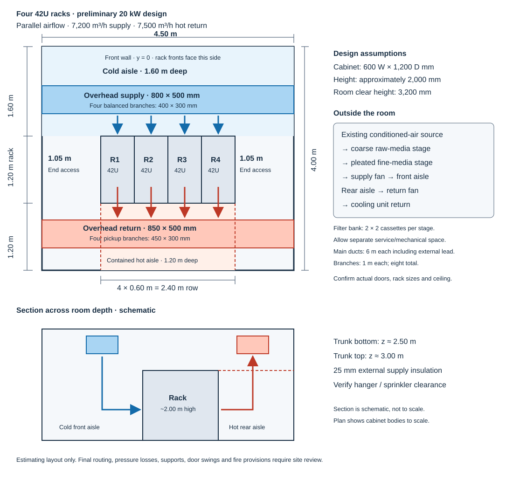
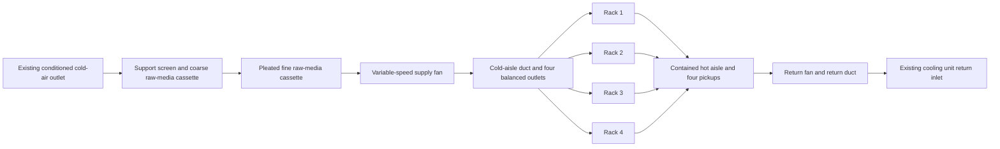

# Four-rack air-quality, airflow design and cost estimate

Prepared 13 October 2026 for Hormuz, Ilam Province, Iran. Currency: **Iranian tomans (IRT); 10 Iranian rials (IRR) = 1 IRT**. This is a preliminary engineering and procurement estimate based on public guidance and price references, not a surveyed construction drawing or a certification of compliance.

## Proposed system and budget

For the **4.5 m × 4 m room with four 42U racks**, use one row of four racks, all facing the same cold aisle. Supply filtered, conditioned air to their fronts; collect their rear exhaust in a contained hot aisle and duct it back to the cooling equipment outside the room. The four racks receive air **in parallel**: hot air leaving one rack must not become another rack's inlet air.

At the provisional **20 kW IT load (5 kW/rack)**, budget **311,496,000 IRT for equipment/materials with 20% contingency**, or **383,496,000 IRT including installation, commissioning and a provisional filter-test allowance**. A sensitivity range is **354–521 million IRT installed**, explained below. This pays for airflow distribution, two fans and filters made from separate raw materials; **it excludes the machine that produces cold air**. Existing cooling must provide approximately **25 kW of usable sensible cooling** for this example, subject to a site heat-load calculation.

The actual rack load, cold-air source, rack dimensions, ceiling height, doors, cooling capacity and duct route are unconfirmed. The repository's earlier [earthing proposal](earthing-proposal.md) mentions a 50 kW facility: that is not evidence of 50 kW IT heat. A 50 kW IT sizing case appears below, but the cost table covers the 20 kW case only.

## International guidance used

The publicly accessible ASHRAE Handbook chapter, contamination guidance, ISO abstracts and published ASHRAE filter-test document were reviewed. Full paid ISO/ISA standards were not purchased or reviewed clause by clause. These references inform the design; local construction/fire requirements and server manufacturer limits still govern installation.

| Reference | Relevant guidance | Design response |
| --- | --- | --- |
| [ASHRAE Handbook, data centers chapter, incorporating 2021 Thermal Guidelines](https://handbook.ashrae.org/Handbooks/A23/IP/A23_Ch20/a23_ch20_ip.aspx) | Recommended A1–A4 inlet temperature: 18–27°C; H1: 18–22°C. Recommended dew point: −9 to 15°C, with an RH ceiling of 70% for low corrosion or 50% for high corrosion. | Initial operating target: 22°C inlet, 40–50% RH, dew point ≤15°C, noncondensing. Confirm equipment class, altitude derating and manufacturer limits. Measure at rack inlets, not a wall thermostat. |
| [ASHRAE 2011 particulate/gaseous contamination guidance](https://www.ashrae.org/file%20library/technical%20resources/publication%20errata%20and%20updates/2011-gaseous-and-particulate-guidelines.pdf) | ISO Class 8 cleanliness; MERV 8 room recirculation and MERV 11, preferably 13, incoming-air filtration. Economizer sites need site-specific filtration. | Target a tested MERV 13 supply assembly; use a separate coarse prefilter to extend its life. Keep construction debris and shedding materials out of the air path. |
| [ISO 14644-1:2015](https://www.iso.org/standard/53394.html) | Classifies airborne cleanliness using particle counts and defined sampling. | Verify room cleanliness with a suitable calibrated particle counter and the standard's sampling procedure. Class 8 reference maxima are 3,520,000/m³ at ≥0.5 μm, 832,000/m³ at ≥1 μm and 29,300/m³ at ≥5 μm, as reproduced in the ASHRAE contamination guidance. A filter label alone does not establish room classification. |
| [ANSI/ASHRAE 52.2-2017, publicly available test method](https://www.ashrae.org/File%20Library/Technical%20Resources/COVID-19/52_2_2017_COVID-19_20200401.pdf) | Laboratory testing assigns particle-size removal performance and MERV at a test airflow. | Test a representative finished homemade cassette at its operating flow; do not assign MERV to a stack of untested cloth. Use the applicable current test edition when commissioning the laboratory. |
| [ISO 16890-1:2016](https://www.iso.org/standard/57864.html) | Classifies general-ventilation filter elements by particulate-matter efficiency (ePM). | Request ISO 16890 reports where available. MERV and ePM ratings use different tests; do not treat them as interchangeable. The ISO catalog also lists a revision in progress; confirm the published edition before ordering tests. |
| [ANSI/ISA-71.04-2013, airborne contaminants](https://www.isa.org/products/ansi-isa-71-04-2013-environmental-conditions-for-p), with [ASHRAE RP-1755 recommendations](https://www.ashrae.org/news/esociety/completed-research-rp-1755-february-2020) | Corrosion monitoring distinguishes low from high contamination: copper <300 Å/month and silver <200 Å/month are the ASHRAE low-corrosion benchmarks. | Expose copper/silver coupons for about 30 days and arrange laboratory analysis at least twice yearly. If results exceed limits, reduce RH to ≤50%, investigate ingress and specify gas treatment suited to the pollutants. |

The 40–50% RH target is this project's conservative operating policy, not the full ASHRAE envelope. Ordinary particle media cannot remove all corrosive gases. A generic carbon sheet does not demonstrate sulfur/chlorine removal; any gas stage needs pollutant-specific media, contact time, breakthrough data and monitoring.

## Heat load and airflow calculation

Assume front-to-rear equipment airflow, 22°C inlet and a **10 K temperature rise** through the servers. A 42U rack specifies usable mounting height, not heat output or external cabinet dimensions. Measure real rack electrical demand and obtain server airflow data before selecting fans.

Use the sensible-heat balance:

```text
Q (m³/s) = P (kW) / [air density (kg/m³) × cp (kJ/kg·K) × ΔT (K)]
cp = 1.005 kJ/kg·K; preliminary inlet density = 1.10 kg/m³
20 / (1.10 × 1.005 × 10) = 1.81 m³/s = 6,513 m³/h
Add approximately 10% airflow reserve: select 7,200 m³/h supply.
```

The density is a planning assumption allowing for elevation; measure site pressure/temperature and correct both heat balance and fan curves. At 32°C, the same mass flow occupies about **7,450 m³/h**; select a return fan for **7,500 m³/h**. This small volumetric difference is thermal expansion, not deliberately extracting more air mass than is supplied. At 7,200 m³/h, a 20 kW load produces about 9 K rise if all delivered air passes through equipment. The reserve accommodates limited leakage, not unlimited bypass.

| IT load | Heat-balance flow at 10 K, 1.10 kg/m³ | Selected cold supply | Per rack, equal loading | Example main supply / return internal size | Supply / return branch size |
| --- | ---: | ---: | ---: | --- | --- |
| 10 kW | 3,257 m³/h | 3,600 m³/h | 900 m³/h | Use baseline ducts with reduced fan speed | Use baseline branches |
| **20 kW baseline** | **6,513 m³/h** | **7,200 m³/h** | **1,800 m³/h** | **800 × 500 / 850 × 500 mm** | **400 × 300 / 450 × 300 mm** |
| 50 kW IT | 16,282 m³/h | 18,000 m³/h | 4,500 m³/h | 1,400 × 750 / 1,450 × 750 mm | 650 × 400 / 650 × 400 mm |

Server manufacturer flow requirements take precedence if greater than the heat-balance result. Unequal rack loads require unequal balancing settings. At 50 kW, allow approximately 18,650 m³/h hot return, a larger filter bank (about 3.6 m² gross face area), and a complete new fan/pressure/budget calculation. Large ducts may require a higher ceiling, external plenums or another cooling architecture; **the baseline system is not a 50 kW system**.

## Room layout and air path



[Open the standalone drawing](airflow-layout.svg). Plan dimensions are to the assumed cabinet bodies. Door swings and fire egress require a site survey.

Use a coordinate system with the southwest room corner at `(0,0)`, the 4.5 m side along x, the 4 m side along y, and the rack fronts facing south:

| Element | Proposed location / size |
| --- | --- |
| Rack bodies | Assume **600 W × 1,200 D × approximately 2,000 H mm**; confirm purchased racks. R1: x=1.05–1.65 m; R2: 1.65–2.25; R3: 2.25–2.85; R4: 2.85–3.45. All y=1.60–2.80 m. |
| Cold front aisle | y=0–1.60 m: **1.60 m deep**. Supply diffusers point down into this aisle, aligned to rack centers. |
| Hot rear aisle | y=2.80–4.00 m: **1.20 m deep**. Contain above the racks and at both row ends using fire-appropriate panels and accessible doors. |
| End access | x=0–1.05 m and 3.45–4.50 m: **1.05 m each**; keep service paths clear. |
| Supply trunk | Over cold aisle, approximately y=0.70–1.20 m, along the row; branches to four front delivery points. |
| Return trunk | Over hot aisle, approximately y=3.10–3.60 m; four pickups from the contained aisle. |
| Vertical space | Assume clear room height **3.20 m**. Baseline trunk bottom at z≈2.50 m, top≈3.00 m; remainder for insulation/hangers. Check beams, cable trays, sprinklers and rack door removal. |
| Filter box and fans | **Outside the 18 m² room**, in an adjacent mechanical/service space. Allow roughly 1.3 W × 1.3 H × 0.9 D m for the filter box plus transitions, fan housings and at least 0.8 m service clearance; actual vendor dimensions govern. |

With 800 mm wide racks the row becomes 3.2 m long and end access shrinks to 0.65 m each; this layout must be revised. If equipment exhausts sideways, provide manufacturer-approved air guides or a different arrangement. Fit blanking panels to unused U positions and seal cable openings and gaps around cabinets; rack internal fans move air through servers. Do not attach duct fans directly to a sealed rack inlet or force a large pressure differential across equipment.



This takes hot air **out of the rack room** and returns it to the cooling unit. If “gives out” means exhausting outdoors, use an economizer arrangement only when outdoor temperature, moisture and contamination permit it. It needs weather louvers, insect screens, motorized intake/exhaust/recirculation dampers, gas treatment when indicated, freeze/condensation protection and mechanical cooling for unsuitable weather. Those items are **outside this baseline budget**. Fans and filters cannot turn warm outdoor air into cold air. Outdoor-air latent load, makeup air and intake/exhaust separation require separate calculation; do not continuously dump purchased conditioned air outdoors.

## Duct sizing, quantities and fan duty

Sizes below are **clear internal width × height**. Retain constant trunk sizes for this small installation; branch dampers balance the declining supply flow and increasing return flow.

| Duct / terminal | Quantity and length | Internal size | Design flow | Velocity |
| --- | --- | --- | ---: | ---: |
| Supply main | 1 × 6 m; 4.5 m room run + 1.5 m external allowance | 800 × 500 mm | 7,200 m³/h maximum | 5.00 m/s |
| Return main | 1 × 6 m; same route allowance | 850 × 500 mm | 7,500 m³/h maximum | 4.90 m/s |
| Supply branches | 4 × 1 m | 400 × 300 mm | 1,800 m³/h each | 4.17 m/s |
| Return branches | 4 × 1 m | 450 × 300 mm | 1,875 m³/h each | 3.86 m/s |
| Supply diffusers | 4 | Approximately 600 × 600 mm gross face | 1,800 m³/h each | ≤2.5 m/s at ≥0.20 m² effective free area |
| Return grilles | 4 | Approximately 600 × 600 mm gross face | 1,875 m³/h each | ≤2.5 m/s at ≥0.21 m² effective free area |

Do not assume gross grille area equals free area. Select terminal throw and pressure loss to reach the lower/middle/upper rack intakes without short-circuiting to return grilles. Check noise during selection.

The fabricated straight-duct sheet area is `2 × (width + height) × length`: supply main **15.6 m²**, return main **16.2 m²**, supply branches **5.6 m²**, return branches **6.0 m²** = **43.4 m²**. Add 30% (**13.02 m²**) for four trunk elbows, eight takeoffs/branch bends, two fan transitions and end closures: **56.42 m², budget rounded to 57 m²**. This fittings allowance must be replaced by a workshop takeoff. The filter housing is costed separately. Cold-side straight area is 21.2 m²; with the same fittings allowance, budget **28 m² external insulation** with continuous vapor sealing. Nominal insulation thickness is 25 mm; verify against room dew point and surface temperature.

Budget 0.6 mm galvanized sheet with flanges, sealed joints and reinforcement. Thickness is a price basis, not a structural approval: a fabricator must verify gauge, bracing and supports for 800–850 mm spans and pressure. Keep sharp/swarf-contaminated surfaces out of the room; clean ducts before installation. Use smooth bends/turning vanes where needed and short vibration-isolating fan connectors.

| Path component | Clean provisional loss | Loaded/design loss |
| --- | ---: | ---: |
| Supply coarse stage | 40 Pa | 150 Pa |
| Supply fine stage | 100 Pa | 250 Pa |
| Supply trunk, branches, bends and transitions, critical path | 80 Pa | 80 Pa |
| Supply terminals and balancing dampers | 80 Pa | 80 Pa |
| Supply selection allowance | 90 Pa | 90 Pa |
| **Supply fan duty** | **390 Pa** | **7,200 m³/h at 650 Pa** |
| Return ducts / fittings | 80 Pa | 80 Pa |
| Return pickups / dampers | 60 Pa | 60 Pa |
| Return selection allowance | 60 Pa | 60 Pa |
| **Return fan duty** | **200 Pa** | **7,500 m³/h at 200 Pa** |

These losses are engineering allowances, not measurements or manufacturer guarantees. Use the longest branch path, not the sum of four parallel branches. Cooling-coil resistance, gas filters, silencers and exterior louvers are not included. Recalculate with their measured/data-sheet losses if present. Pressure across server internals is handled by server fans, not inserted as an arbitrary HVAC duct loss.

Select continuous-duty backward-curved centrifugal fans with approved variable-speed control, motor protection and accessible isolation. Starting motor allowances are **3 kW supply and 1.5 kW return**. At 60% combined fan/motor efficiency, the design duties imply about **2.17 + 0.69 = 2.86 kW input**, below motor nameplate totals. Verify power, stability, density corrections and sound from actual curves. [AMCA's fan-selection explanation](https://www.amca.org/educate/articles-and-technical-papers/amca-inmotion-articles/straightening-out-fan-curves.html) shows why flow and pressure must be selected together; a free-air m³/h listing does not prove this duty.

Coordinate both fans with the existing cooling unit. Control supply to measured flow and trim return to maintain near-neutral aisle pressure without opposing server fans. Balance mass flow using temperature/density corrections; avoid negative room pressure drawing unfiltered air through doors. The baseline has **one supply and one return fan, no redundancy**. Either fan failing must alarm and trigger load reduction/shutdown if inlet conditions cannot be maintained. N+1 fans, bypass/isolation arrangements and backup cooling need a separate quote. If the existing cooling-unit fans can meet the complete external static requirement, omit the additional fans/drives after verification and revise the budget.

## Filters assembled layer by layer

Purchase **raw media and individual frame materials**, not packaged finished filters. Construct two independent, gasketed stages; do not compress all layers together. Buy offcuts/by-area where available; if a supplier requires a full roll, the cash purchase can exceed the usable-area budget.

The bank contains **four nominal 600 × 600 mm cassettes in parallel per stage**, arranged 2 × 2. Gross bank face: 1.44 m²; assumed clear face per cassette: 550 × 550 mm, total **1.21 m²**. At 7,200 m³/h, clear face velocity is **1.65 m/s**, and each cassette carries 1,800 m³/h. Verify the purchased media's permissible velocity and pressure loss.

| Airflow order | DIY layer / construction | Purchase quantity | Purpose |
| --- | --- | ---: | --- |
| 1 | Deburred rigid support mesh, mechanically retained in the coarse frames | 2 m² | Prevent media collapse; not a fine-particle filter |
| 2 | 10–20 mm non-shedding synthetic coarse filter roll, cut to four panels | 2 m² | Intercept large dust; includes trim/spare material. Require actual efficiency and pressure data rather than relying on an old G4 label. |
| 3 | Separate pleated synthetic fine-media stage, **target tested MERV 13** | 12 m² raw fine media | Four 100 mm deep cassettes; do not substitute a flat pad of unknown resistance/efficiency |
| 4 | Fine-media backing/scrim or pleat separators compatible with that media | 12 m² allowance | Retain pleat spacing and fibers; may be factory bonded to raw media, in which case remove duplicate backing cost |
| Around every stage | Eight reusable rigid frames, closed-cell gaskets, compatible low-emission sealant and clamps | 8 frames + 1 seal lot | Eliminate edge bypass and allow each stage to be replaced separately |

For estimating, use **100 mm pleat depth and 25 mm pitch**. Media-to-face ratio is approximately `2 × sqrt(100² + 12.5²) / 25 = 8.06`. Thus four 0.55 × 0.55 m openings need approximately **9.76 m² fine media**, rounded to **12 m² purchased** for cuts and losses. Media velocity is about **0.20 m/s**. Obtain the media maker's permissible pleating radius, support method, clean loss and dust-loading performance; revise pleat geometry if required. Keep space between stages, use slide-out access and install pressure taps before/after each stage.

[Kapron's Iranian roll-media offering](https://kapron-filter.com/product/فیلتر-رولی/) confirms locally available cuttable coarse media but gives **quotation-only pricing**. It is not evidence that the homemade final assembly achieves MERV 13. Obtain fine raw-media specifications and test a representative finished cassette, including seal and pressure performance. Do not operate valuable equipment behind an assembly with unverified shedding, bypass or efficiency. HEPA is not a default requirement for this room and would need a different pressure/assembly design.

If corrosion measurements call for gas treatment, add a separate, contained sorbent bed with downstream dust retention and specified dwell time. Loose carbon granules, an unspecified carbon cloth or additional coarse pads are not a demonstrated solution. That stage and its extra fan pressure are excluded pending pollutant testing.

## Itemized one-time cost table

All values are IRT. The [editable CSV](airflow-estimate.csv) includes quantities, unit prices, line totals and source/assumption notes. No equipment was ordered and no supplier was contacted.

**Price basis:** [Sazaab's opened duct table](https://sazaab.com/کانال-هوا/) lists 0.6 mm galvanized rectangular duct with galvanized flanges at **8,400,000 IRR/m² = 840,000 IRT/m²**; update date and installation inclusion are unclear. It is used as a fabrication reference, with installation separately allowed. [Fanmarket's opened backward-fan catalog](https://fanmarket.ir/product-category/فن-سانتریفیوژ/فن-سانتریفیوژ-بکوارد/) displays ABA-56 at **23,000,000 IRT**, ABA-63 at **29,600,000 IRT** and ABA-71 variants around **42–43 million IRT**. These are price benchmarks only, **not selected or verified fans at the required pressure**. Allow 40 million IRT per fan until duty-point quotations arrive. All other prices below are explicit planning allowances, not researched supplier offers.

| Item | Quantity | Unit IRT | Line IRT | Basis / scope |
| --- | ---: | ---: | ---: | --- |
| Fabricated galvanized ducts, flanges and estimated fittings | 57 m² | 840,000 | 47,880,000 | Sazaab price reference; gauge/bracing to be confirmed |
| External cold-duct insulation and vapor seal | 28 m² | 350,000 | 9,800,000 | Allowance; installed insulation |
| Centrifugal fans | 2 | 40,000,000 | 80,000,000 | Allowance informed by catalog; distinct supply/return duties |
| Compatible variable-speed drives / fan controls | 2 | 12,000,000 | 24,000,000 | Allowance; verify motor compatibility |
| Filter-bank housing with slide rails and access doors | 1 | 12,000,000 | 12,000,000 | Custom fabrication allowance, separate from ducts |
| Reusable cassette frames | 8 | 600,000 | 4,800,000 | Four per stage; no finished filter packs |
| Coarse-stage support mesh | 2 m² | 300,000 | 600,000 | Raw material allowance |
| Coarse synthetic raw filter media | 2 m² | 450,000 | 900,000 | Quote required; trim/spare included |
| Pleatable fine raw filter media | 12 m² | 1,200,000 | 14,400,000 | Quote required; target tested final MERV 13 |
| Fine-media backing / separators | 12 m² | 150,000 | 1,800,000 | Raw material allowance |
| Filter gaskets, clamps and sealant | 1 lot | 2,000,000 | 2,000,000 | Allowance |
| Supply diffusers / return grilles | 8 | 1,500,000 | 12,000,000 | Four of each; effective free area as specified |
| Manual branch balancing dampers | 8 | 800,000 | 6,400,000 | Allowance |
| Fan flexible connectors / vibration isolation | 2 sets | 1,000,000 | 2,000,000 | Allowance |
| Duct hangers and reinforcement allowance | 1 lot | 5,000,000 | 5,000,000 | Confirm no duplicate charge in fabrication quote |
| Hot-aisle roof/end containment, doors, blanking/sealing | 1 lot | 18,000,000 | 18,000,000 | Fire-appropriate material allowance |
| Electrical protection, isolation and local wiring | 1 lot | 8,000,000 | 8,000,000 | Existing adequate power supply assumed |
| Pressure indication, taps and airflow proving / alarm hardware | 1 lot | 6,000,000 | 6,000,000 | Use existing rack inlet temperature/RH monitoring |
| Local transport and freight | 1 lot | 4,000,000 | 4,000,000 | Domestic allowance |
| **Equipment/materials subtotal** | | | **259,580,000** | Includes fabricated components and installed insulation |
| Mechanical/electrical installation labor | 1 lot | 20,000,000 | 20,000,000 | Allowance excluding already included fabrication/insulation work |
| Air balancing, commissioning and particle/coupon baseline sampling | 1 lot | 15,000,000 | 15,000,000 | Allowance; confirm lab analysis scope |
| Representative finished-filter laboratory testing | 1 lot | 25,000,000 | 25,000,000 | Provisional allowance; laboratory availability/quote needed |
| **Installed subtotal before contingency** | | | **319,580,000** | |
| **20% contingency on installed subtotal** | | | **63,916,000** | |
| **Installed planning total** | | | **383,496,000** | Approximately **383.5 million IRT** |

If self-installing, equipment/materials with their own 20% contingency cost **311,496,000 IRT**, but commissioning and laboratory testing remain necessary costs. The filter housing plus raw materials/frames/seals total **36,500,000 IRT** before contingency; no assembled filter pack is included. Retain tax, transport and workshop scope on each quotation to avoid double counting. Additional VAT, imports, major wall openings, fire/smoke dampers where required, silencing, cooling plant, humidity control, outdoor-air hardware, N+1 redundancy and existing monitoring upgrades are excluded.

### Estimate uncertainty and operating cost

The sensitivity range varies duct fabrication from **840,000–1,800,000 IRT/m²**, each fan from **30–65 million IRT**, and fine raw media from **800,000–2,000,000 IRT/m²**. The high duct rate is a small-job budgeting scenario, not a supplier quotation. Keep all other rows fixed, add the 60 million IRT labor/testing allowances and apply 20% contingency: **353,736,000–520,680,000 IRT**. This is a procurement sensitivity exercise, not a statistically guaranteed range. Obtain quotes especially for reinforcement, fans, filter media and test services.

At the provisional loaded-fan input of 2.86 kW, continuous operation consumes about **25,100 kWh/year**; at electricity price `T` IRT/kWh, annual fan energy is approximately `25,100 × T` IRT. Mechanical cooling electricity is additional. Do not use the 4.5 kW summed motor nameplates as measured operating power.

For a starting replacement budget, assume four coarse-stage changes and two fine-stage changes per year. Using the same purchased-area allowances gives **32,400,000 IRT/year in raw media**, plus seals, labor, shipping, tests and disposal. Actual intervals depend on dust loading and pressure drop, not the calendar alone. Do not wash fine media unless its manufacturer explicitly supports it.

## Installation and acceptance

1. Survey rack loads and airflow direction, rack bodies, altitude, ceiling, access, cooling supply/return duty and power. Confirm cooling can support sensible load plus fan/envelope gains at peak conditions. Verify containment and any required penetration/fire provisions with the installation designer.
2. Finalize duct routing, fitting takeoff, reinforcement, coil/terminal pressure losses and fan curves. Fabricate filter samples and obtain efficiency, pressure and shedding evidence before installing them in service.
3. Install/clean ducts, insulated supply, filter housing, containment, dampers, protected fans and controls. Preserve rack/aisle access and coordinate containment with detection and suppression systems.
4. Measure supply/return flow by a calibrated duct traverse or suitable flow hood. Set equal-load baseline branches near **1,800 m³/h supply** and **1,875 m³/h return**, then adjust for actual rack loads and density. Check fan motor current, static pressure and filter differential pressures at clean and design-loaded resistance.
5. Record inlet temperature/RH at lower, middle and upper points of all racks using the [existing monitoring proposal](../assets/park/rack-monitoring-proposal.md). Demonstrate all occupied inlets meet equipment requirements under expected maximum load; inspect bottom-of-rack delivery and hot-air leakage. A wall-average reading is insufficient.
6. Log clean filter pressure drops. Initially investigate coarse loss approaching 150 Pa or fine loss approaching 250 Pa; use the actual media maker's lower terminal limits where specified. Alarm on low flow, fan failure and unexpectedly low filter pressure (possible missing media/bypass), as well as inlet overtemperature. Test alarms and controlled load reduction without overheating production equipment.
7. Perform ISO 14644-1 particle sampling with a qualified instrument/procedure and establish copper/silver coupon results. A consumer PM sensor cannot prove ISO Class 8. If either test fails, correct leakage, shedding, filtration or pollutant ingress and repeat. Confirm the final cassette test meets the chosen MERV/ePM target; the estimate itself makes no compliance claim.
8. Observe the complete system over at least 72 hours including high load, and retain balancing readings, fan curves, filter test reports, drawings and replacement instructions. Allow roughly **2–3 weeks for fabrication/installation after parts arrive**, plus laboratory lead time and the approximately 30-day coupon exposure. Do not declare corrosion acceptance before results return.

Before procurement, the decisive inputs are measured peak IT kW, cooling-source details, actual rack widths/depths, ceiling clearance and duty-point supplier quotations. These can change both dimensions and the budget materially.
