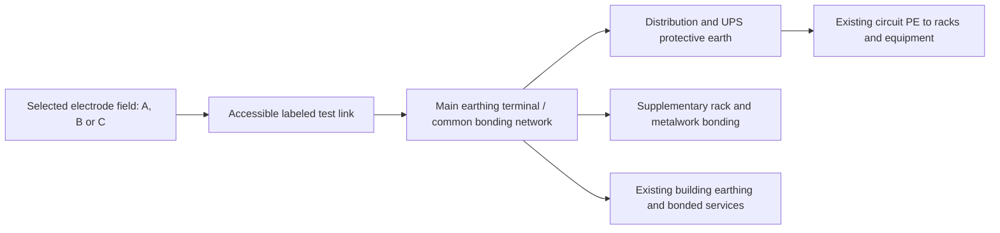

# Electrical earth-pit proposals for the 50 kW Hormuz mini datacenter

Prepared 13 October 2026. Currency: **Iranian tomans (IRT), not rials**. This proposal interprets “earth hole” as an **electrical earthing pit (چاه ارت)**. It assumes the existing Hormuz site in Ilam Province and four racks described in the repository. The exact address, soil, electrical drawings and installed equipment have not been surveyed. The dimensions below are **estimating layouts**, not a construction design or a guaranteed earth resistance.

## Recommendation and alternatives

First measure and inspect the building's existing earthing and bonding. A sound existing system may only need repair and rack bonding, saving the cost of a new electrode. If an electrode extension is needed, start with **method A: spaced driven rods**, subject to the soil survey. It uses ordinary civil tools plus a hired rod driver and test instruments, and can be extended after measurements. Choose **method B: a shallow ring with rods** when perimeter space is available and a distributed electrode is justified. Choose **method C: a copper-plate pit** when a specialist confirms that a deeper conductive layer makes it worthwhile and machinery can reach the site.

| Method | Estimating layout | When it fits | Main limitation | Owner hours / elapsed time after delivery |
| --- | --- | --- | --- | --- |
| A: driven rods | Three 3 m rods, approximately 6 m apart, bonded by a buried triangle | Driveable soil, modest space; simplest starting option | Rock/refusal or dry soil may require relocation, deeper rods or more electrodes | 40–56 h / 1–2 weeks |
| B: shallow ring + rods | Approximately 30 m perimeter, four 3 m rods; ring about 0.6–0.8 m deep | Accessible perimeter and distributed bonding | More trench work; shallow dry soil may still perform poorly | 80–112 h / 2–3 weeks |
| C: conventional plate pit | One 600 × 600 × 5 mm solid copper plate; provisional 0.8 m diameter × 4 m machine-excavated shaft | Confirmed favorable deeper soil and limited surface space | Highest excavation risk; one plate may fail the measured target | 24–40 owner h plus crew / 1–2 weeks |

These times assume workable soil, approved plans, available contractors and one owner working roughly eight hours/day. Add **1–3 weeks before construction** for survey, supplier quotes, design review and scheduling; approvals or hard ground can extend this. Method C is a project managed by one person, **not a one-person digging job**. For A and B, the owner can do approved shallow civil work, preparation and records; the estimate still includes specialist electrical work and testing.

## What the 50 kW rating does and does not tell us

For an assumed 400 V three-phase supply at power factor 0.9, `I = 50,000 / (sqrt(3) × 400 × 0.9) ≈ 80 A`. This is an illustrative operating current, **not** the prospective fault current or a feeder/breaker specification. If 50 kW is IT load alone, cooling and UPS losses increase facility demand.

Electrode resistance depends on soil resistivity, moisture, geometry and depth. A single rod or plate cannot be promised to achieve 1 or 2 ohms. Soil measurements and local constraints must select the final layout. [nVent soil measurement and electrode-design guidance](https://blog.nvent.com/soil-resistivity-measurement-ground-electrode-design-principles-and-testing/).

The electrician must identify TN-S/TN-C-S, TT or another supply arrangement, and check utility, UPS, bypass and generator operating modes. In TT, earth resistance and RCD selection are coordinated; the usual relationship is `RA × IΔn ≤ 50 V`, with applicable disconnection times and any stricter conditions also met. In TN, the metallic protective-conductor return path and earth-fault loop impedance are central to breaker operation. A low-resistance pit alone does not establish protection. [Schneider TT principle](https://www.electrical-installation.org/enwiki/TT_system_-_Principle), [Schneider TN principle](https://www.electrical-installation.org/enwiki/TN_system_-_Principle).

**50 mm² copper for the electrode feeder and 16 mm² for supplementary rack bonding are budgeting assumptions.** Final conductor sizes depend on fault current, clearing time, conductor installation and mechanical/corrosion requirements; for thermal sizing the designer may use `S ≥ sqrt(I²t)/k`. Existing circuit PE conductors remain necessary. [Schneider protective-conductor sizing](https://www.electrical-installation.org/enwiki/Sizing_of_protective_earthing_conductor).

The acceptance sheet must state the required electrode resistance and protection tests before procurement. **≤2 Ω may be requested as a provisional project goal**, but is not asserted here as a universal Iranian/datacenter requirement. Confirm the applicable Iranian requirements with the responsible local electrical engineer and utility; this research did not establish a site-specific legal threshold. If testing fails the agreed criteria, extend or redesign the electrode and revise the estimate before accepting it.

## Shared electrical arrangement and preparation

All alternatives connect to the building's **main earthing terminal (MET)** and common equipotential bonding network. Do not create an isolated “clean earth” for racks or introduce an arbitrary neutral-to-earth connection downstream. UPS and generator neutral/bond switching must follow the actual equipment documentation and reviewed electrical design. Existing lightning protection and surge protection need coordination with this common network; this estimate does not replace their design.

Use a short, protected route to the MET. Keep connectors accessible where possible; buried connectors must be approved for their conductor combination and direct burial, or use correctly specified exothermic joints installed by a trained contractor. Do not put a switch or fuse in the PE path. The test link is for controlled testing, not routine disconnection.

Before any ground work, obtain landowner permission, locate buried power, water, gas and communication lines, and confirm distances from foundations, other electrodes and services with the designer. Mark and barricade the work area. [OSHA excavation utility-location guidance](https://www.osha.gov/laws-regs/regulations/standardnumber/1926/1926.651) provides a useful safety reference; it is not an assertion of Iranian jurisdiction.

## Price basis and shared item list

**1 USD = 270,000 IRT**, exactly as requested. If a quotation is in IRR, divide by ten to obtain IRT. Persian product listings were checked/opened on 13 October 2026; displayed prices are indicative and can be stale or change at checkout. Opened copper-wire and category prices supersede lower search summaries. No orders or supplier contacts were made.

Each option includes **one copy of the following common list**, plus its own list below. The tables include materials, tools and paid human resources. Rows shown as “$… allowance” are **unquoted estimating assumptions**, converted at the requested rate, not researched US retail prices. They cover items/services for which a reliable comparable local quote was not established. Obtain written Ilam quotes before purchase; currency conversion does not establish local labor rates.

| Item | Quantity | Unit IRT | Line IRT | Price basis |
| --- | ---: | ---: | ---: | --- |
| 50 mm² insulated green/yellow copper electrode feeder | 20 m | 1,620,000 | 32,400,000 | $6 allowance |
| 16 mm² insulated copper supplementary rack bonding | 20 m | 540,000 | 10,800,000 | $2 allowance |
| Main earthing bar with supports and enclosure | 1 set | 4,050,000 | 4,050,000 | $15 allowance |
| Accessible test-link box | 1 each | 960,000 | 960,000 | [Persian listing](https://elabkhand.com/product-category/well-art/) |
| 50 mm² copper lugs | 4 each | 235,000 | 940,000 | [Persian listing](https://elabkhand.com/product-category/well-art/) |
| Rack lugs and bonding bolts/washers | 1 lot | 3,240,000 | 3,240,000 | $12 allowance |
| Protective conduit and route fixings | 20 m | 270,000 | 5,400,000 | $1 allowance |
| Labels and corrosion-compatible joint protection | 1 lot | 2,160,000 | 2,160,000 | $8 allowance |
| Hand tools and PPE purchase allowance | 1 lot | 9,450,000 | 9,450,000 | $35 allowance |
| Hydraulic crimper and torque tool hire | 1 lot | 5,400,000 | 5,400,000 | $20 allowance |
| Freight and local transport | 1 lot | 4,050,000 | 4,050,000 | $15 allowance |
| Electrical survey and soil resistivity design | 1 visit | 16,200,000 | 16,200,000 | $60 allowance |
| Electrical integration under isolation | 1 visit | 10,800,000 | 10,800,000 | $40 allowance |
| Commissioning test equipment and written report | 1 visit | 16,200,000 | 16,200,000 | $60 allowance |

**Shared cash subtotal: 122,050,000 IRT**, before contingency. The two cable allowances are deliberately distinct: insulated feeder on the route to the MET, and supplementary rack bonds. Electrode conductor buried in soil is costed separately in each method. Existing rack/PDU circuit PE is assumed present and will be tested. Increase quantities if the measured route exceeds 20 m or rack bonding exceeds 20 m.

The main-bar allowance includes its enclosure/supports; the separate test-link box serves electrode testing. Confirm the box actually contains a suitable removable link; add one if it does not. Tools include measuring tape, spade, pick, hammer, wheelbarrow, cable cutters, drill, gloves, boots, eye/ear protection and temporary barriers as a shared purchase/hire allowance. Hire crimping/torque equipment rather than improvise terminations. The survey and commissioning service allowances include the required specialist test instruments; an ordinary multimeter cannot measure electrode resistance correctly.

### A — Driven-rod electrode

Allow a roughly triangular area with 6 m sides, subject to access and clearances. Three 3 m rods give an extensible starting layout. Rod spacing is intentional: closely clustered rods interfere with each other's earth-current paths; three rods do not simply divide resistance by three. Use the measured soil model to predict performance before choosing the final count.

| Item | Quantity | Unit IRT | Line IRT | Price basis |
| --- | ---: | ---: | ---: | --- |
| 3 m × 16 mm copper-coated steel earth rod | 3 each | 230,000 | 690,000 | [Persian listing](https://coppersland.ir/product/میله-ارت-روکش-مس/) |
| 50 mm² bare copper conductor | 25 m | 1,575,000 | 39,375,000 | [Persian listing](https://elabkhand.com/product/copper-wire-50/) |
| Approved rod clamps and conductor splice connectors | 1 lot | 5,400,000 | 5,400,000 | $20 allowance |
| Concrete inspection chamber and lid | 3 each | 1,700,000 | 5,100,000 | [Persian listing](https://elabkhand.com/product-category/well-art/) |
| Rod driver rental and compatible drive head | 1 lot | 8,100,000 | 8,100,000 | $30 allowance |
| Screened backfill and minor reinstatement | 1 lot | 5,400,000 | 5,400,000 | $20 allowance |
| Rod installation contractor allowance | 3 rod | 2,000,000 | 6,000,000 | [Service midpoint](https://sanjagh.pro/price/اجرای-چاه-ارت-و-سیستم-ارتینگ) |

The rod supplier displays **230,000 IRT for a 3 m × 16 mm copper-coated rod**, but the catalog is undated and does not establish coating thickness or certification. This is a provisional price, **not approval of that product**. Require certified copper-bonded rods to the designer's accepted specification; update costs if the listing is unsuitable. The bare-wire listing is treated as **per metre**, consistent with its 450 g description, but confirm sale unit and actual 50 mm² copper section with the supplier. [Local rod specification/price table](https://coppersland.ir/product/میله-ارت-روکش-مس/), [local copper-wire listing](https://elabkhand.com/product/copper-wire-50/).

Procedure:

1. Complete the shared survey/design steps and set out rods and the protected feeder route.
2. Excavate the approved shallow connecting trench; for estimating, 18 m × 0.3 m × 0.6 m is about **3.2 m³**, before feeder-route trenching. Keep spoil and barriers clear of edges. Work from the surface where possible.
3. Have the installer drive the rods using the correct drive head. Stop on refusal rather than bend rods or damage copper coating; an engineer must approve couplers, extensions or relocation.
4. Lay the continuous bare copper connection, attach approved clamps/joints, and fit chambers with accessible heads. Protect exposed cable in conduit. Do not add improvised salt/charcoal mixtures.
5. Photograph geometry and joints; perform the preliminary electrode test before irreversible reinstatement. If insufficient, revise the field rather than concealing the result.
6. Backfill/compact in suitable layers, reinstate surfaces, and complete the shared electrical integration and acceptance tests.

Owner time allocation: survey coordination/procurement 8 h, shallow trench/reinstatement 24 h, route and chamber preparation 8 h, test attendance and records 8 h: **48 h base**, typically **40–56 h**. Paid specialists: approximately **12 common hours + 8 rod-installation person-hours**, excluding the owner's labor. Rock or separate feeder trenching can add days.

### B — Shallow perimeter ring with four rods

Use a surveyed perimeter around an accessible yard/building, for example a 10 m × 5 m rectangle with **30 m perimeter**, provided foundation and utility clearances permit it. Place rods at well-spaced points selected by the designer. This provides a distributed electrode and expansion points; it still requires testing and does not guarantee the resistance goal.

| Item | Quantity | Unit IRT | Line IRT | Price basis |
| --- | ---: | ---: | ---: | --- |
| 50 mm² bare copper ring conductor | 35 m | 1,575,000 | 55,125,000 | [Persian listing](https://elabkhand.com/product/copper-wire-50/) |
| 3 m × 16 mm copper-coated steel earth rod | 4 each | 230,000 | 920,000 | [Persian listing](https://coppersland.ir/product/میله-ارت-روکش-مس/) |
| Approved buried ring/rod/feeder connectors | 1 lot | 8,100,000 | 8,100,000 | $30 allowance |
| Concrete inspection chamber and lid | 4 each | 1,700,000 | 6,800,000 | [Persian listing](https://elabkhand.com/product-category/well-art/) |
| Rod driver rental and drive head | 1 lot | 8,100,000 | 8,100,000 | $30 allowance |
| Screened backfill and reinstatement | 1 lot | 10,800,000 | 10,800,000 | $40 allowance |
| Rod installation contractor allowance | 4 rod | 2,000,000 | 8,000,000 | [Service midpoint](https://sanjagh.pro/price/اجرای-چاه-ارت-و-سیستم-ارتینگ) |

Procedure:

1. Survey the full perimeter and feeder route; confirm that excavating will not undermine the building or cross unknown utilities.
2. Mark the ring and excavate an approved trench approximately 0.6–0.8 m deep. At 0.7 m × 0.3 m × 30 m, nominal volume is **6.3 m³**; access, safe side slopes and reinstatement can enlarge this.
3. Drive four approved rods using hired equipment/installer. Lay bare copper around the perimeter and close the ring with an approved joint; connect rods and the feeder. Fit accessible inspection chambers.
4. Inspect and photograph joints before covering. Test the electrode; revise geometry or add electrodes if necessary.
5. Backfill, compact, restore surfaces and commission the common bonding network.

Owner allocation: planning/materials 12 h, trench and reinstatement 56 h, ring/route/chamber preparation 20 h, test attendance/records 8 h: **96 h base**, typically **80–112 h**. Paid specialists: approximately **12 common hours + 12 rod-installation person-hours**. One owner can perform approved shallow work in workable soil, but helpers or a hired mini excavator are practical for rocky ground; neither additional help nor a mini excavator is included. Stop and reprice if manual excavation is impractical.

### C — Conventional copper-plate pit

Use this only after soil measurements justify a deeper electrode. The **4 m depth is a cost assumption**, not a depth inferred from the 50 kW load. Do not keep deepening a pit blindly to chase a resistance value. Budgeted plate is 600 × 600 × 5 mm solid copper; verify purity, dimensions and approximately 16.1 kg theoretical mass rather than accepting a cheaper cast/alloy substitute.

| Item | Quantity | Unit IRT | Line IRT | Price basis |
| --- | ---: | ---: | ---: | --- |
| 600 × 600 × 5 mm copper plate | 1 each | 45,600,000 | 45,600,000 | [Persian listing](https://elabkhand.com/product-category/well-art/) |
| 50 mm² bare copper pit tail | 10 m | 1,575,000 | 15,750,000 | [Persian listing](https://elabkhand.com/product/copper-wire-50/) |
| 15 kg earthing backfill bag (local GEM-labelled product) | 20 bag | 520,000 | 10,400,000 | [Persian listing](https://elabkhand.com/product-category/well-art/) |
| Concrete inspection chamber and lid | 1 each | 1,700,000 | 1,700,000 | [Persian listing](https://elabkhand.com/product-category/well-art/) |
| Approved buried tail-to-feeder connector | 1 each | 2,160,000 | 2,160,000 | $8 allowance |
| Water mixing containers screened backfill and reinstatement | 1 lot | 8,100,000 | 8,100,000 | $30 allowance |
| Specialist machine excavation crew and mobilization | 1 job | 40,500,000 | 40,500,000 | $150 allowance |
| Plate installation | 1 plate | 2,250,000 | 2,250,000 | [Service midpoint](https://sanjagh.pro/price/اجرای-چاه-ارت-و-سیستم-ارتینگ) |
| Exothermic plate joint service including consumables | 1 joint | 1,620,000 | 1,620,000 | $6 allowance |

The 300 kg backfill amount is a **provisional envelope around the electrode**, not the entire shaft fill. Determine actual material volume from the approved envelope and manufacturer's yield/mixing instructions. Remaining excavation is backfilled with suitable soil. A Persian product labeled “GEM” has not been established as nVent-branded or technically equivalent; obtain its composition, corrosion performance and installation instructions. Plain bentonite may shrink away from an electrode in dry conditions. [nVent technical handbook](https://www.nvent.com/sites/default/files/acquiadam/assets/E907W-WWEN.pdf), [nVent enhancement-material selection guidance](https://blog.nvent.com/lower-your-grounding-system-resistance-with-ground-enhancement-material-gem/).

Procedure:

1. Confirm the soil layer, groundwater conditions, machine access and excavation design; obtain a specialist excavation quote covering shaft stability, any necessary casing, spoil handling, surface barriers and non-entry electrode installation.
2. Prepare the plate/tail joint above ground using the correct exothermic mold/charge and trained installer. Inspect the connection before lowering.
3. The specialist machine-excavates the approved shaft. At 0.8 m diameter × 4 m depth, nominal shaft volume is about **2.0 m³**, excluding access works. **Nobody enters the shaft under this proposal.** If entry becomes necessary, stop: a separately engineered excavation/entry/rescue plan and revised crew/budget are required.
4. Lower the plate in the orientation specified by the engineer, normally vertical, using a suitable lifting arrangement. Place the specified electrode backfill from the surface, then restore native soil with the approved compaction method. Do not pull/lift the plate by the electrical tail.
5. Terminate at the accessible test point, inspect/test, then complete surface restoration and common commissioning. If resistance fails, consider additional separated electrodes rather than accepting an inadequate pit.

Deep excavation is not suitable for a lone person with hand tools. Cave-in protection and a competent excavation assessment are essential; even shallow excavation can be unstable. [OSHA trench/excavation safety reference](https://www.osha.gov/sites/default/files/publications/TRENCH_EXCAVATION_FS.pdf).

Owner allocation: planning/scheduling 12 h, above-ground route preparation 12 h, specialist attendance and records 8 h: **32 h base**, typically **24–40 h**. Paid resources: **12 common specialist hours**, an excavation crew allowance of **3 people × 8 h = 24 person-hours**, approximately **4 plate-installation hours**, and **2 exothermic-joint hours**. The excavation package includes its machinery and crew; these person-hours are descriptive and are not charged again. Restricted access, rock, dewatering or extensive casing need a new quote.

## Financial comparison

Cash costs include materials, tool/service allowances and the paid specialists in the tables. Add **25% contingency to the entire cash subtotal**. Owner time is shown separately at an assumed **500,000 IRT/hour**; it is opportunity cost for comparison, not a sourced wage and not payable when you do it yourself. It does not replace specialist hours already in the cash budget.

| Method | Cash before contingency IRT | 25% contingency IRT | Owner-managed cash budget IRT | Owner time value IRT | Cash + owner time value IRT |
| --- | ---: | ---: | ---: | ---: | ---: |
| A — rods | 192,115,000 | 48,028,750 | **240,143,750** | 24,000,000 | **264,143,750** |
| B — ring | 219,895,000 | 54,973,750 | **274,868,750** | 48,000,000 | **322,868,750** |
| C — plate pit | 250,130,000 | 62,532,500 | **312,662,500** | 16,000,000 | **328,662,500** |

These are preliminary estimates, **not fixed contractor offers**. The precise arithmetic supports auditability; practical funding allowances are approximately **240 million IRT (A), 275 million IRT (B), and 313 million IRT (C)**. The 25% reserve covers small price/quantity changes, not an unbounded redesign or a guarantee that additional electrodes fit the reserve.

The Persian service marketplace lists rod installation at 1.5–2.5 million IRT per rod and plate installation at 1.5–3 million IRT per plate, both excluding excavation/welding; their midpoints are used here. These are published service benchmarks, not Ilam offers or surveyed wages. Its published exothermic-joint line applies to **70 mm² and above**, so it was not presented as a verified 50 mm² price. [Persian installation service table](https://sanjagh.pro/price/اجرای-چاه-ارت-و-سیستم-ارتینگ).

The baseline assumes an existing functioning distribution system, UPS, generator arrangements where present, rack/PDU circuit PE and existing building bonding. **Not included:** new feeders, breakers/RCDs, SPDs, lightning air terminals/down conductors, utility supply changes, generator/UPS rewiring, major rack/metalwork bonding beyond the stated 20 m, major paving/foundation repair, land costs, public-road works, international import costs, and taxes added above displayed prices. The survey must identify these before construction. Additional feeder-route excavation, permit/inspection charges and unusually extensive underground-utility surveys require local quotes; the current common survey allowance must not be assumed sufficient for them.

If the owner is electrically qualified and supplies accepted instruments, some services may be performed personally after the site design is approved. Do not delete testing or commissioning from the scope to save money. For ongoing budgeting, reserve an **unquoted $60/year = 16,200,000 IRT/year** for an inspection/retest visit, plus repairs. Confirm the final inspection frequency and service quote locally.

## Implementation sequence and acceptance

1. **Measure first:** collect the site plan, existing electrode reports and single-line diagram; confirm whether 50 kW is IT or total load. A specialist performs soil resistivity measurements (e.g. Wenner four-point at multiple spacings) and evaluates existing electrode/bonding condition. Record dry-season conditions where possible.
2. **Complete the design:** specify electrode geometry, certified materials, conductor sizes, protection criteria and UPS/generator/bypass bonding. Select A/B/C from measured conditions; obtain local engineering/utility requirements and any civil permits before digging.
3. **Price the actual bill:** obtain at least two written local offers using the table quantities, verifying metre/kg sale units, rod coating and plate purity. Separate installation labor, excavation and testing so packages are not double-counted. Approve a revised bill if the measured route or layout differs.
4. **Procure and prepare:** inspect materials, schedule excavation/installers/tester, mark utilities and barriers, and arrange an electrical maintenance window. UPS/batteries/generator can keep equipment energized after mains isolation; the electrician must control every source relevant to the work.
5. **Build the selected field** using its procedure above. Photograph and record location, depth, cable routes and all buried joints before backfilling. Use manufacturer-approved enhancement material only if included in the approved design; no improvised salt/charcoal treatment is specified.
6. **Integrate during controlled isolation:** the electrician verifies absence of voltage as required and connects to the common MET/bonding network. Never remove the only protective-earth connection from operating equipment to measure a pit.
7. **Commission and document:** a competent tester measures electrode resistance using fall-of-potential with adequate probe separation and several potential-probe positions to demonstrate a valid curve/plateau. A clamp-only tester cannot prove an isolated new electrode's resistance because it needs parallel return paths. If separation cannot be achieved on site, specify a suitable alternative professional method and report its limitations. [Megger testing guidance](https://www.megger.com/en-gb/et-online/november-2007/a-guide-to-earth-testing), [Megger earth-resistance surveys](https://www.megger.com/en-us/et-online/december-2018/Earth%20resistance%20testing%3A%20Why%20and%20how%3F).
8. **Accept only after protection checks:** record MET-to-rack/metalwork low-resistance continuity, visual/torque inspections, applicable earth-fault loop and RCD operation/disconnection checks, and operation-mode verification for utility, UPS/bypass and generator. Compare results with the approved design, not just an ohm target. Correct failures and retest before putting affected circuits in service.
9. **Hand over and maintain:** keep drawings, material certificates, photos, test instrument/calibration details, weather/soil conditions and signed results. Recheck in the dry season, after relevant electrical/civil changes or lightning damage, and at the responsible engineer's agreed interval. A freshly wetted acceptance reading alone is insufficient evidence of year-round performance.

The editable [itemized estimate CSV](earthing-estimate.csv) records quantities, original currency, exchange rate, IRT line totals, evidence type, sources and owner hours. Use it to replace provisional allowances with supplier quotations before implementing the work.
