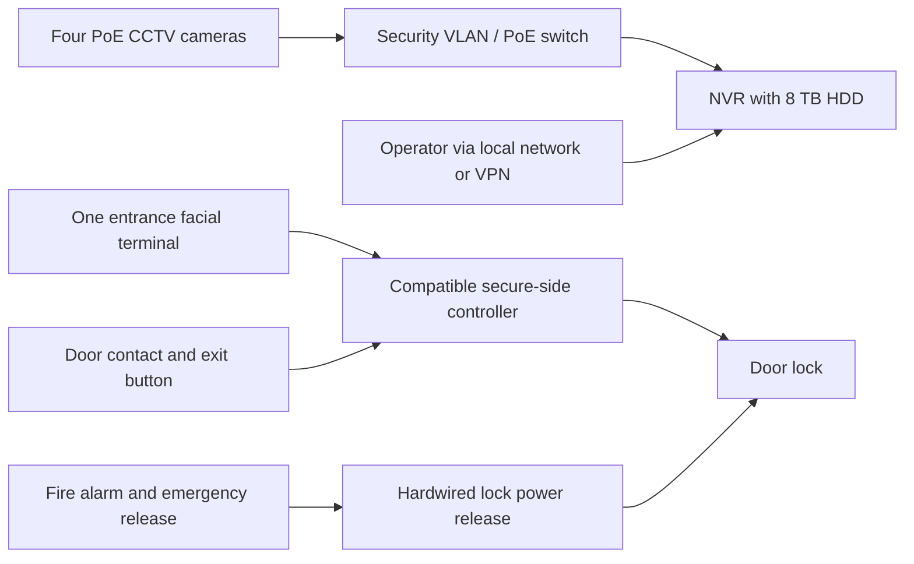

# Data center CCTV and facial entrance access proposal

Prepared for Hormuz Data Center on 13 October 2026. Currency: **Iranian tomans (IRT)**; 1 IRT = 10 Iranian rials (IRR).

## Recommendation and design basis

Install **four wired IP cameras and one facial recognition terminal controlling one entrance door**, with local video recording and local authorized-person access. Budget **311,491,200 IRT (311.4912 million tomans)** installed, including 20% contingency, before applicable tax. The itemized estimate is also available in [security-estimate.csv](security-estimate.csv).

This preliminary proposal assumes the existing **four-rack, 4.5 m × 4 m room**, one entrance, an indoor approach corridor, an existing firewall/VPN, fire alarm and UPS-backed supply. The survey must confirm door material/rating, rack arrangement, camera sight lines, lighting, cable routes and spare UPS capacity. Four cameras are a starting quantity; racks may create blind spots that require repositioning or additional cameras. The facial terminal is separate from the four CCTV cameras. No second facial reader is required for exit.

| Device | Proposed position | Purpose |
| --- | --- | --- |
| C1 | Approach corridor, facing the entrance approach | Record approaching people with a useful face view |
| C2 | Inside entrance, facing door and room threshold | Record entries, exits and possible tailgating |
| C3 | High at one end of the rack front aisle | Monitor rack-front activity |
| C4 | High at the opposite end of the rear/service aisle | Monitor rear access and service activity |
| F1 | Outside entrance at an accessible manufacturer-approved height | Authenticate enrolled authorized staff and request door release |

Use fixed 4 MP PoE cameras with H.265, wide dynamic range and infrared night imaging; select 2.8 mm or 4 mm lenses after a temporary positioning test. Camera specification reference: [Hikvision DS-2CD2143G2-IU datasheet](https://www.hikvision.com/content/dam/hikvision/usa/data-sheet/acusense-series/Datasheet-for-DS-2CD2143G2-IU.pdf). Require readable activity views with racks and doors in their actual positions, including lights-off tests. Disable microphones in this installation. Do not point cameras directly into screens or private areas; use privacy masks where appropriate.

## Recording, network and power

Connect four cameras to a managed PoE switch on a dedicated security VLAN. Connect the NVR, terminal and secure-side door controller to the restricted security network; allow administration only from approved operator devices or through the existing VPN. Use an **8-channel NVR with two SATA bays**, leaving four video channels and one disk bay for expansion. NVR reference: [Hikvision DS-7608NXI-K2](https://pro-av.hikvision.com/es-co/products/IP-Products/Network-Video-Recorders/Pro-Series/ds-7608nxi-k2/). The priced base model has no PoE, so the separate PoE switch is intentional. Confirm the exact regional model, firmware, disk compatibility, decoding and recording capacities before purchase.

Record continuously, initially at 4 MP, 15 frames/s, H.265 and a **4 Mbit/s maximum recording bitrate per camera**. Target 30 days of footage. Decimal storage calculation: `4 × 4,000,000 / 8 × 86,400 × 30 = 5.184 TB`; adding a 20% sizing margin gives **6.2208 TB**. One nominal **8 TB surveillance HDD** should fit this configuration after formatting and recorder reserves, subject to commissioning measurements. At 6 Mbit/s per camera the same margin needs 9.3312 TB, requiring a storage revision. Do not rely on motion-only recording to meet the stated retention. Verify visual quality before lowering bitrate.

The single disk is **not redundant**; disk or NVR failure can lose footage. Export incident clips promptly to an existing restricted backup destination, retaining original files, timestamps and an export log. The second bay is expansion capacity, not a promise of RAID support. Continuous replicated recording or edge SD backup is outside the base estimate.

Feed the switch, NVR, monitor as needed, access PSU and controller from the existing UPS. Allow an initial **150 W design load excluding the monitor**, then measure actual consumption and revise UPS runtime calculations. Require at least 120 W total PoE budget for the four cameras with reserve; verify per-port limits and camera maximum loads. Supply the terminal through its specified DC input unless the exact purchased variant explicitly supports PoE. The door lock needs its own correctly rated fused supply; never feed it from the reader relay contacts as a power source. Separate signal cabling from power circuits, seal penetrations appropriately and label both ends.

## Facial access and door operation

Here, “Face ID” means a **dedicated facial access terminal**, such as a compatible Hikvision DS-K1T342 variant or an equivalent product, using locally enrolled biometric templates. Require configurable anti-spoofing/liveness detection, local authorization schedules, event export, tamper monitoring and supported connection to a protected controller. [Hikvision DS-K1T342 series manual](https://www.hikvision.com/content/dam/hikvision/products/S000000001/S000000080/S000000103/S000000107/OFR000141/M000054133/User_Manual/UD25849B-C_Baseline_DS-K1T342-Series-Face-Recognition-Terminal_User-Manual_V3.0_20240219.pdf) describes the anti-spoofing settings. This is a procurement requirement, not a guarantee that every spoof attempt is prevented.

Store door-release relays and authorization control inside the secured room. The vendor must demonstrate that removing, shorting or disconnecting the outside terminal cannot unlock the door. Confirm the terminal/controller protocol and offline behavior as a pair before ordering; an exposed terminal with its own lock relay is not the proposed secure arrangement. Prefer an authenticated encrypted reader link where supported. Do not assume Wiegand or any RS-485 interface is encrypted. Replace the reference product if it cannot meet the required architecture; the controller row is an allowance for a qualified compatible set.

Enroll staff only after an administrator verifies identity and approves access hours. A successful match for an active authorized person requests a short release, initially 5 seconds; denied, expired or unenrolled people remain locked out. Record granted/denied authentication, enrollment changes and door events. Configure door-held-open (initially 30 seconds) and forced-open alarms, with local indication and tested operator notification. Synchronize CCTV and access clocks to local NTP so incidents can be correlated by time. Automated video/access-event integration is optional and not priced.

Use **free exit from inside**, an inside request-to-exit button, a door-position sensor, a closer, an emergency break-glass release and a hardwired fire-alarm release. The base allowance assumes a fail-safe magnetic lock: loss of lock power unlocks the door. Fire-alarm and emergency release must interrupt lock power even while the UPS is running, independently of software or LAN. A qualified door/fire installer must confirm the design against the actual door, escape route and applicable local requirements before fitting. If a rated door needs a different lock or mechanical panic hardware, revise the allowance and preserve its rating.

On LAN/Internet failure, local recording and enrolled-person entry must continue, and events must be buffered for later export. On reader/controller failure, outside access uses a documented supervised/key procedure while free exit remains available. On UPS exhaustion the fail-safe lock releases, requiring a security response. Keep a controlled emergency key/override procedure and supervised non-biometric fallback for enrollment failures. Facial access alone does not stop tailgating; require visitors to be escorted and review the doorway cameras. A mantrap or turnstile is outside scope.

Restrict biometric template and footage access to designated administrators, use unique passwords and least-privilege accounts, disable vendor cloud/P2P and unused services, and apply supported firmware after testing. Keep templates local; disable unnecessary captured-face image storage where supported. Provide an enrollment notice and a documented fallback process. Proposed policy: overwrite ordinary video after 30 days, retain access logs for 90 days, remove biometric templates promptly when access ends, and retain incident evidence only under the site's approved incident policy. Confirm these retention periods with the operator before commissioning and include backups in deletion procedures.

## Price table and summation

Prices checked on 13 October 2026 are indicative and not binding quotes. The two linked Persian supplier pages were opened: the camera page displayed **15,544,000 tomans**, and the NVR page displayed **19,900,000 tomans**. Confirm stock, genuine hardware, exact suffix, warranty, freight and tax in written offers. All other rows are **direct IRT planning allowances**, not verified market prices. In particular, no verifiable local facial-terminal/controller quote was established; replace those allowances with a compatible system bid. No currency exchange conversion is used. Divide any rial quote by ten before comparing it.

| Item | Quantity | Unit IRT | Line IRT | Price basis |
| --- | ---: | ---: | ---: | --- |
| C01: 4 MP PoE dome cameras, DS-2CD2143G2-IU reference | 4 each | 15,544,000 | 62,176,000 | [Displayed supplier price; confirm lens and warranty](https://hikstore.net/product/ds-2cd2143g2-iu/) |
| C02: 8-channel two-bay NVR, DS-7608NXI-K2 reference (no PoE) | 1 each | 19,900,000 | 19,900,000 | [Displayed supplier price; disks excluded](https://eye3.ir/product/hikvision-nvr-8-channel-ds-7608nxi-k2/) |
| C03: 8 TB surveillance-rated HDD | 1 each | 25,000,000 | 25,000,000 | Planning allowance; confirm NVR compatibility |
| C04: Managed 8-port PoE switch with uplink and >=120 W budget | 1 each | 12,000,000 | 12,000,000 | Planning allowance |
| C05: Local monitor and HDMI cable | 1 set | 8,000,000 | 8,000,000 | Planning allowance |
| A01: One facial recognition terminal with liveness detection | 1 each | 55,000,000 | 55,000,000 | Planning allowance; DS-K1T342 series or equivalent; exact variant subject to compatibility |
| A02: Secure-side door controller/relay interface and enclosure | 1 set | 15,000,000 | 15,000,000 | Planning allowance; require supported reader protocol and offline authorization |
| A03: Fail-safe electromagnetic lock and door brackets | 1 set | 8,000,000 | 8,000,000 | Planning allowance; door suitability to be surveyed |
| A04: Regulated fused access-control PSU and protected wiring | 1 set | 5,000,000 | 5,000,000 | Planning allowance; size to terminal/controller/lock loads |
| A05: Door closer and minor fitting work | 1 set | 4,000,000 | 4,000,000 | Planning allowance; preserve fire-door rating |
| A06: Door-position contact | 1 each | 500,000 | 500,000 | Planning allowance |
| A07: Inside request-to-exit button | 1 each | 800,000 | 800,000 | Planning allowance |
| A08: Emergency break-glass release | 1 each | 1,200,000 | 1,200,000 | Planning allowance; hardwired power interruption |
| A09: Fire-alarm release interface and functional test | 1 set | 2,000,000 | 2,000,000 | Planning allowance; assumes existing fire alarm with compatible output |
| I01: Solid-copper Cat6 cable | 100 m | 60,000 | 6,000,000 | Planning allowance; provisional route quantity |
| I02: Containment, camera boxes, connectors and labels | 1 lot | 4,000,000 | 4,000,000 | Planning allowance |
| I03: Cabling, mounting and door hardware installation | 1 service | 20,000,000 | 20,000,000 | Planning allowance; specialist installer |
| I04: Configuration, enrollment, commissioning and training | 1 service | 8,000,000 | 8,000,000 | Planning allowance |
| I05: Domestic delivery | 1 service | 3,000,000 | 3,000,000 | Planning allowance |
| **Installed subtotal** | | | **259,576,000** | Hardware, materials and services |
| **Contingency: 20% of subtotal** | | | **51,915,200** | Price movement and minor omissions |
| **Planning installed total before tax** | | | **311,491,200** | **311.4912 million tomans** |

| Cost group | IRT |
| --- | ---: |
| Video equipment | 127,076,000 |
| Entrance access equipment | 91,500,000 |
| Shared cabling and materials | 10,000,000 |
| Installation, configuration and delivery | 31,000,000 |
| Subtotal | 259,576,000 |
| Contingency | 51,915,200 |
| **Total** | **311,491,200** |

Add applicable tax only to the supplier-confirmed taxable scope. Excluded: new UPS/fire-alarm/firewall purchase, major door replacement or civil works, outdoor perimeter coverage, staffed surveillance, paid software subscriptions, new backup storage, redundant recording, mantrap/turnstile and recurring maintenance. The base system requires no cloud subscription; confirm any vendor management/export licensing in the bid. Existing shared UPS and network infrastructure are assumed available and are not charged again. Contingency does not fund excluded projects.

## Installation and acceptance

Allow **3–5 working days on site after delivery**, including installer and operator time: survey and temporary camera positioning; cable and door hardware installation; recorder/network configuration and enrollment; functional testing and handover. Follow with a 72-hour recording observation period. The door and fire-release work needs a qualified specialist; the site owner can coordinate the project and administer access.

| Acceptance check | Required evidence |
| --- | --- |
| Coverage | Walk-through footage of all agreed aisles and both sides of the entrance, including night/light-off views; document residual blind spots |
| Recording | All four channels record and play back continuously; verify clock agreement, disk-health alerts, restart recovery and usable incident export |
| Retention | Measure daily disk consumption during the observation period, project at least 30 days with reserve, then confirm oldest footage at day 30 |
| Access | Each enrolled person tested in actual lighting; test unenrolled/revoked/out-of-hours users, retry handling and printed-photo/phone-screen spoof attempts; investigate any unauthorized release |
| Door security | Forced/held-open and terminal tamper events detected; removal/disconnection of outside reader cannot release lock |
| Escape and fire | Demonstrate exit button, emergency release and simulated fire signal while UPS powered, independently of network/controller software; record installer sign-off |
| Outages | Demonstrate local recording and authorized entry during LAN/Internet loss; verify mains-to-UPS continuity, safe exit on controller failure, and expected lock state on total power loss |
| Handover | Provide as-built camera positions, wiring, model/serial list, protected configuration backups, operator training, incident export procedure and access revocation procedure |

Review camera/disk status daily, investigate door alarms immediately, review access permissions monthly, test recording export and door releases periodically with the installer, and plan disk replacement from health trends and warranty. Recheck coverage whenever racks move. Obtain the site survey and itemized compatible-system quotations before releasing procurement.
